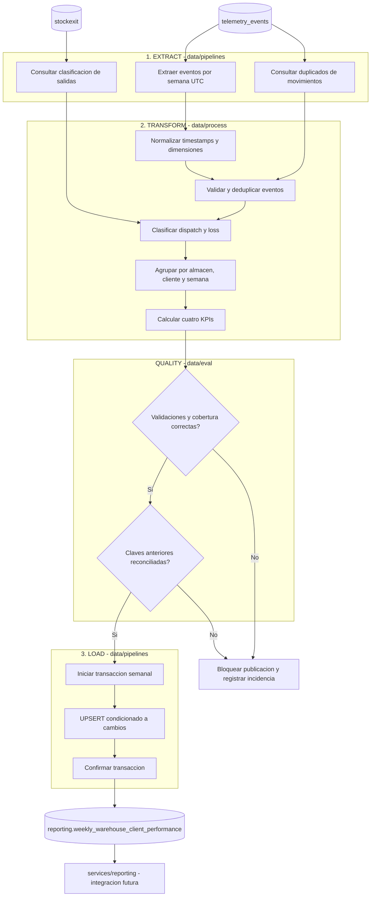
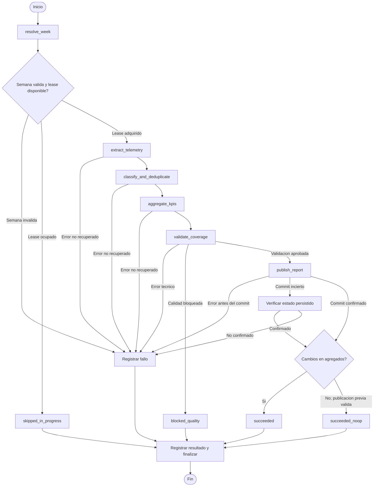
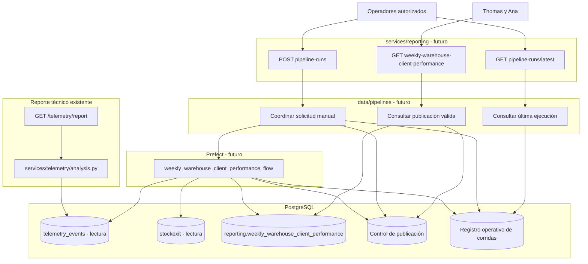

# TrackFlow — Business Performance Pipeline Design

## Current State — Estado actual

TrackFlow dispone de una capa de telemetría que valida y persiste eventos operativos. Los eventos pueden ser emitidos desde el backend o recibidos mediante `POST /telemetry/events`. El análisis existente consulta la tabla con SQL y procesa los resultados con Pandas.

La tabla `telemetry_events` contiene `id`, `timestamp`, `service`, `event_type`, `level`, `value`, `message` y `tags`. Las dimensiones de negocio, incluidas las de almacén y cliente, se almacenan en `tags` como JSONB, no en columnas dedicadas.

El envelope de telemetría incluye `eventId`, pero la persistencia no lo conserva en una columna. Por tanto, la tabla no permite deduplicar por ese identificador. Tampoco tiene una columna `inserted_at` para distinguir cuándo ocurrió un evento de cuándo se almacenó.

Los productores backend implementados son:

- `inbound_order_created`, emitido desde `create_stock_entry()`. Incluye dimensiones como almacén, cliente, cantidad e identificador del movimiento.
- `outbound_order_created`, emitido desde `create_stock_exit()`. La emisión actual no distingue entre salidas `dispatch` y `loss`, por lo que su conteo puede incluir movimientos que no representan pedidos despachados.

La captura de inbound y outbound puede omitirse si falta `client_id` o no se resuelve un almacén canónico. Además, los movimientos de negocio se confirman antes de persistir su evento de telemetría: si falla esa persistencia, el movimiento no se revierte y el evento puede faltar.

La auditoría confirmó que `stock_threshold_triggered` e `inventory_discrepancy_detected` tienen contratos de propiedades, pero no productores backend implementados. El evento `inventory_stock_insufficient` sí existe y se utiliza en el análisis técnico; no equivale a `stock_threshold_triggered`.

El reporte técnico actual agrega estas métricas:

- `event_volume_by_day_and_type`
- `operational_failures_by_type_and_day`
- `stock_insufficiency_by_day_warehouse_category`, basada en `inventory_stock_insufficient`
- `auth_failure_rate`, calculada diariamente a partir de eventos de inicio de sesión exitoso y fallido.

El endpoint `GET /telemetry/report` acepta un periodo explícito o utiliza los últimos siete días por defecto; el reporte se almacena en caché durante 60 segundos. El dashboard de telemetría del backoffice consume este endpoint y presenta métricas técnicas, no KPIs de negocio ni una agregación semanal por cliente y almacén.

No se ha verificado una generación programada del reporte los lunes; Prefect no está instalado.

## Business Gap — Brecha de negocio

Thomas, CEO, y Ana, responsable de Operaciones de Almacén, necesitan un **Reporte Semanal de Desempeño por Almacén y Cliente**, actualizado el lunes por la mañana. Su objetivo es reemplazar la consolidación manual que realizan los directores y disponer de una vista semanal del desempeño de negocio.

El entregable requerido tiene granularidad `warehouse + client_id + week_start`, con semanas ISO que comienzan el lunes en UTC. La futura tabla destino es `reporting.weekly_warehouse_client_performance`.

Para este reporte, `telemetry_events` será la fuente principal en modo solo lectura. La tabla de destino y el reporte semanal de negocio no son funcionalidades implementadas actualmente.

### KPIs obligatorios

| KPI | Definición |
|---|---|
| `inbound_units_count` | Suma de unidades recibidas mediante eventos `inbound_order_created`. |
| `outbound_orders_count` | Conteo de pedidos despachados mediante eventos `outbound_order_created`. |
| `stockout_events_count` | Conteo de eventos `stock_threshold_triggered`. |
| `discrepancy_rate` | `discrepancy_events_count / outbound_orders_count`; el resultado es `0` cuando `outbound_orders_count = 0`. |

`discrepancy_events_count` es un conteo de apoyo de `inventory_discrepancy_detected`, no un KPI adicional. El contrato define una razón agregada dentro de la granularidad requerida; no exige asociar cada discrepancia con un pedido outbound individual.

### Limitaciones del reporte actual

El reporte técnico existente no cubre esta necesidad: sus métricas describen volumen y fallos técnicos de eventos, insuficiencia de stock y fallos de autenticación.

No calcula los cuatro KPIs solicitados ni los agrupa por almacén, cliente y semana. Además, el conteo actual de `outbound_order_created` puede incluir salidas `loss`, lo que impide interpretarlo sin reservas como cantidad de pedidos despachados.

Antes de considerar confiables los KPIs, hay dependencias de cobertura y semántica pendientes:

- No existen productores para `stock_threshold_triggered` e `inventory_discrepancy_detected`.
- Algunos eventos inbound/outbound pueden omitirse cuando faltan dimensiones.
- El evento outbound no diferencia actualmente `dispatch` de `loss`.
- La persistencia no conserva `eventId`, lo que limita la identificación de duplicados.
- No existe `inserted_at` para identificar directamente cuándo llegó un evento a la base de datos.

La ausencia de filas en telemetría no debe interpretarse automáticamente como cero incidencias. Para los eventos sin productor, un conteo vacío no demuestra que no ocurrieran incidentes.

También puede faltar telemetría de movimientos existentes por dimensiones ausentes o errores de persistencia. La falta de `inserted_at` impide determinar directamente el momento de llegada del registro y evaluar esa latencia a partir de la tabla.

### Referencias técnicas

Los componentes existentes relevantes para este diseño se encuentran en:

- `infra/sql/telemetry_events.sql`
- `services/api/telemetry_storage.py`
- `services/api/inventory_service.py`
- `services/telemetry/analysis.py`
- `services/api/routes/telemetry.py`
- `uis/backoffice/app/backoffice/telemetry/page.tsx`

La información descrita corresponde a la inspección del código y los contratos existentes. No se ha realizado una nueva consulta a la base de datos de producción para verificar cobertura histórica, volúmenes o reconciliación con movimientos de negocio.

## Pipeline Purpose — Propósito del pipeline

El pipeline producirá el **Reporte Semanal de Desempeño por Almacén y Cliente** de TrackFlow para Thomas (CEO) y Ana (Head of Warehouse Operations).

Se ejecutará semanalmente para generar el consolidado de la semana ISO UTC anterior, de modo que el resultado esté disponible el lunes por la mañana.

Cada fila representará una única combinación de:

`warehouse + client_id + week_start`

El pipeline calculará los cuatro KPIs establecidos en el BRIEFING:

| KPI | Campo | Evento de origen | Cálculo |
|---|---|---|---|
| Volumen de entrada | `inbound_units_count` | `inbound_order_created` | Suma de unidades recibidas. |
| Throughput de salida | `outbound_orders_count` | `outbound_order_created` | Conteo de salidas válidas clasificadas como `dispatch`, sujeto a la correspondencia con pedidos comerciales. |
| Frecuencia de quiebre de stock | `stockout_events_count` | `stock_threshold_triggered` | Conteo de eventos bajo el mínimo configurado. |
| Tasa de discrepancia | `discrepancy_rate` | `inventory_discrepancy_detected` y pedidos de salida | Eventos de discrepancia divididos entre pedidos de salida. |

`discrepancy_events_count` será el conteo auxiliar necesario para calcular la tasa de discrepancia.

La fuente principal será `telemetry_events`, utilizada exclusivamente en modo de lectura. El pipeline será independiente del reporte técnico existente.

## Extract — Extracción

### Fuente y selección de eventos

La extracción consultará exclusivamente los cuatro `event_type` obligatorios:

- `inbound_order_created`
- `outbound_order_created`
- `stock_threshold_triggered`
- `inventory_discrepancy_detected`

No se sustituirá ninguno por otro evento. En particular, `inventory_stock_insufficient` no equivale a `stock_threshold_triggered`.

Los campos estructurales necesarios serán:

| Campo | Uso |
|---|---|
| `id` | Identificar y rastrear cada fila persistida. |
| `timestamp` | Filtrar eventos y calcular su semana ISO UTC. |
| `event_type` | Identificar la operación correspondiente a cada KPI. |
| `service` | Verificar procedencia y detectar inconsistencias. |
| `tags` | Obtener dimensiones, cantidades e identificadores de movimientos. |

Desde `tags` se extraerán:

| Propiedad | Uso |
|---|---|
| `warehouse` | Dimensión obligatoria de almacén. |
| `client_id` | Dimensión obligatoria de cliente. |
| `quantity` | Unidades recibidas para inbound. |
| `movement_id` | Identificar movimientos inbound/outbound y detectar duplicados. |
| `product_id` | Validación auxiliar de consistencia, cuando corresponda. |

Los campos `level`, `value` y `message` no participarán en los cálculos de los cuatro KPIs. En particular, `value` no reemplazará a `tags.quantity`.

No se asumirá que existen columnas `eventId` o `inserted_at` en el almacenamiento actual.

### Ventana temporal

Cada ejecución resolverá los límites de una semana ISO completa utilizando UTC.

- `week_start`: lunes a las 00:00 UTC.
- `next_week_start`: lunes siguiente a las 00:00 UTC.

La extracción utilizará el intervalo semiabierto:

```sql
timestamp >= :week_start
AND timestamp < :next_week_start
```

Esto impide contar dos veces eventos situados exactamente en el límite entre semanas.

La ventana no dependerá de los últimos siete días móviles ni de las zonas horarias locales de Los Ángeles y Zaragoza.

Los eventos se atribuirán a la semana correspondiente a su `timestamp` normalizado a UTC.

### Validaciones de entrada

Antes de permitir que los eventos contribuyan al agregado:

1. `timestamp` deberá contener un instante válido.
2. `event_type` deberá coincidir con uno de los cuatro tipos admitidos.
3. `tags` deberá contener un objeto JSON válido.
4. `warehouse` deberá corresponder a un almacén canónico o a un alias documentado.
5. `client_id` deberá ser un identificador no vacío, compatible con el contrato del dominio.
6. `quantity`, para inbound, deberá representar un entero positivo.
7. `movement_id`, para inbound/outbound, deberá identificar un movimiento válido.
8. Una procedencia inesperada deberá registrarse como incidencia de validación.

Las cantidades no válidas no se redondearán ni sustituirán por cero. Los booleanos, valores negativos, fracciones y nulos no serán cantidades inbound válidas.

Los eventos con dimensiones ausentes o inconsistentes quedarán separados de los agregados, conservando su identificador de telemetría y la razón del rechazo.

No se crearán valores genéricos como `unknown` para mezclar clientes o almacenes.

### Ubicación arquitectónica

La solución respetará las responsabilidades establecidas por el ejercicio:

| Ubicación | Responsabilidad |
|---|---|
| `data/pipelines/` | Coordinar extracción, transformaciones y futura carga. |
| `data/process/` | Transformaciones reutilizables, normalización, deduplicación y agregación. |
| `data/raw/` | Área opcional; no se requiere almacenar una copia de eventos para esta versión. |
| `data/eval/` | Verificaciones de calidad, cobertura e invariantes. |
| `services/reporting/` | Futuros endpoints HTTP de consulta y ejecución. |
| `services/telemetry/` | Mantener intacto el reporte técnico anterior. |

La dirección de dependencias será:

```text
services/reporting/
        |
        v
data/pipelines/
        |
        v
data/process/
```

Los endpoints HTTP importarán las funcionalidades del pipeline. El pipeline no dependerá de los servicios HTTP.

Las operaciones de lectura de `telemetry_events` y las consultas auxiliares serán coordinadas desde `data/pipelines/`. No se añadirán las nuevas transformaciones a `services/telemetry/analysis.py`.

## Transform — Transformación

### Normalización temporal

Todos los timestamps serán convertidos a UTC antes de calcular fechas y semanas.

El valor `week_start` será el lunes correspondiente a la semana ISO del evento.

No se asignarán zonas horarias arbitrarias a valores ambiguos. Los timestamps inválidos deberán registrarse como incidencias de calidad.

### Normalización de almacenes

Los almacenes admitidos son:

- `los_angeles`
- `zaragoza`

Cuando existan valores históricos reconocidos, podrán normalizarse mediante las reglas documentadas en `canonical_telemetry_warehouse()`.

Por ejemplo:

| Valor reconocido | Valor canónico |
|---|---|
| `LA` | `los_angeles` |
| `Los Angeles` | `los_angeles` |
| `ZGZ` | `zaragoza` |
| `Zaragoza` | `zaragoza` |

No se utilizarán coincidencias aproximadas ni almacenes predeterminados.

### Validación de clientes

`client_id` deberá conservar la identidad real del cliente asociado al evento.

La validación comprobará:

- Existencia y tipo del identificador.
- Compatibilidad con el formato del dominio.
- Consistencia con el movimiento cuando exista una relación verificable.
- Posibles contradicciones de identidad.

El registro vigente de `inventory_clients.py` podrá utilizarse como referencia, pero no como lista excluyente de todos los clientes históricos.

Un identificador histórico compatible que no aparezca en el registro actual no será rechazado automáticamente. Podrá conservarse en resultados de revisión, señalando que su identidad histórica requiere validación.

Los identificadores ausentes, inválidos o contradictorios se separarán del conjunto agregable.

No se sustituirá `client_id` por nombres, usuarios ni identificadores generados.

### Deduplicación de eventos

La deduplicación debe distinguir entre filas técnicas y acciones de inventario.

**Filas persistidas**

Si una operación de lectura devuelve repetidamente el mismo `telemetry_events.id`, se conservará una única aparición.

**Movimientos inbound y outbound**

Se utilizará como clave lógica disponible:

```text
(event_type, movement_id)
```

`event_type` es necesario porque `StockEntry` y `StockExit` utilizan espacios independientes de identificadores.

Para cada clave:

- Las apariciones consistentes podrán consolidarse en una contribución.
- Las diferencias en cliente, almacén, cantidad o producto se tratarán como conflictos.
- Una diferencia de timestamp dentro de la misma semana no implicará automáticamente otro movimiento.
- Una aparición del mismo movimiento en semanas diferentes generará un conflicto de atribución temporal.

Para detectar duplicados entre semanas, se consultarán las demás apariciones disponibles de las claves encontradas, sin limitar esa comprobación a la semana solicitada.

No se elegirá arbitrariamente el timestamp más antiguo, el más reciente ni el UUID de una fila para resolver conflictos.

Cuando existan timestamps contradictorios entre semanas, se requerirá una política documentada y evidencia autorizada antes de atribuir definitivamente el movimiento a una semana.

**Eventos de stockout y discrepancias**

Actualmente no existe una clave persistida de ocurrencia de negocio que permita deduplicarlos con certeza.

Por tanto:

- No se eliminarán filas diferentes únicamente porque compartan timestamp, producto, cliente o almacén.
- No se asumirá que dos objetos JSON idénticos representan necesariamente el mismo incidente.
- Cada fila persistida distinta podrá representar un evento observado, sujeto a las limitaciones de captura.
- La deduplicación exacta requerirá una identidad estable en la instrumentación futura.

Esta estrategia reduce duplicados conocidos, pero no garantiza por sí sola deduplicación completa de todos los eventos.

### Clasificación de salidas outbound

El productor actual emite `outbound_order_created` para movimientos `dispatch` y `loss`.

Como `exit_type` no está disponible en `telemetry_events.tags`, se utilizará una consulta auxiliar de solo lectura a `stockexit`, relacionando:

```text
telemetry_events.tags.movement_id
                |
                v
          stockexit.id
                |
                v
          stockexit.exit_type
```

La clasificación tendrá las siguientes reglas:

| Clasificación | Tratamiento |
|---|---|
| `dispatch` confirmado | Contribuye una vez al conteo de salida, después de deduplicar. |
| `loss` confirmado | No contribuye al conteo de pedidos despachados. |
| Movimiento no encontrado | Incidencia de clasificación; no se presume `dispatch`. |
| Tipo desconocido | Incidencia; no se incorpora silenciosamente. |
| Datos inconsistentes | Separa el movimiento y registra el conflicto. |
| Consulta auxiliar fallida | La transformación se considera incompleta. |

La consulta auxiliar no reemplaza a `telemetry_events` como fuente principal y no incorporará movimientos sin eventos de telemetría.

**Limitación semántica:** el modelo actual registra movimientos `StockExit`. No está confirmado que cada movimiento `dispatch` represente exactamente un pedido comercial único.

El conteo de movimientos `dispatch` observados será una base calculable. Para considerarlo equivalente a `outbound_orders_count`, deberá confirmarse la correspondencia entre movimientos y pedidos.

Esta condición también afecta la interpretación del denominador de `discrepancy_rate`, sin modificar la fórmula exigida.

### Agregación semanal

Los eventos aceptados se agruparán exclusivamente por:

```text
warehouse
client_id
week_start
```

Para cada combinación se calculará:

**Volumen de entrada**

```text
inbound_units_count =
    SUM(quantity de inbound_order_created válidos y deduplicados)
```

**Throughput de salida**

```text
outbound_orders_count =
    COUNT(movimientos outbound válidos,
          deduplicados y clasificados como dispatch)
```

Este conteo queda sujeto a la confirmación semántica de movimiento frente a pedido comercial.

**Eventos de stockout**

```text
stockout_events_count =
    COUNT(stock_threshold_triggered válidos)
```

**Eventos de discrepancia**

```text
discrepancy_events_count =
    COUNT(inventory_discrepancy_detected válidos)
```

**Tasa de discrepancia**

```text
if outbound_orders_count == 0:
    discrepancy_rate = 0
else:
    discrepancy_rate =
        discrepancy_events_count / outbound_orders_count
```

La división será decimal. `discrepancy_rate` representa una razón, no un porcentaje multiplicado por 100, y no se limitará artificialmente a 1.

Un movimiento outbound de varias unidades aporta un movimiento al conteo, no su cantidad de unidades.

### Combinaciones sin actividad

El diseño inicial producirá combinaciones derivadas de los eventos válidos observados.

No generará automáticamente todas las combinaciones posibles de clientes y almacenes, porque no se ha establecido una fuente autorizada que demuestre cuáles relaciones deben existir durante cada semana.

Los períodos o combinaciones sin eventos deberán distinguirse de los casos en los que la captura no estuvo disponible.

## Cobertura y confiabilidad

Actualmente, `stock_threshold_triggered` e `inventory_discrepancy_detected` carecen de productores implementados.

Por ello, debemos distinguir:

| Estado | Interpretación |
|---|---|
| Actividad cero verificada | Captura operativa y cobertura suficiente, sin ocurrencias durante el período. |
| Captura inexistente | No se cuenta con instrumentación para detectar el evento. |
| Captura incompleta | Existen fallos, eventos rechazados o cobertura insuficiente. |
| KPI no confiable | No puede presentarse como un indicador de negocio completo. |

La ausencia de registros no demuestra automáticamente que no hayan ocurrido incidentes.

Mientras falten productores o garantías de cobertura, podrán existir resultados internos de revisión, pero el reporte no deberá presentarse como un consolidado completo y confiable de los cuatro KPIs.

Las incidencias de calidad y cobertura se documentarán separadamente de los campos del agregado.

## Contrato de salida de transformación

Cada agregado semanal contendrá los siguientes campos:

| Campo | Tipo lógico | Descripción |
|---|---|---|
| `warehouse` | Texto | Almacén canónico. |
| `client_id` | Texto | Identificador del cliente. |
| `week_start` | Fecha | Lunes de la semana ISO UTC. |
| `inbound_units_count` | Entero | Total de unidades recibidas. |
| `outbound_orders_count` | Entero | Total de pedidos de salida, sujeto a la correspondencia semántica validada. |
| `stockout_events_count` | Entero | Eventos bajo el mínimo configurado. |
| `discrepancy_events_count` | Entero | Conteo auxiliar de discrepancias. |
| `discrepancy_rate` | Decimal | Cociente entre discrepancias y pedidos de salida. |

Invariantes obligatorias:

- Una única combinación de almacén, cliente y semana por agregado.
- Ninguna fila mezcla clientes ni almacenes.
- Todos los eventos contribuyentes pertenecen a la semana correspondiente.
- Los movimientos `loss` no contribuyen al throughput.
- Las unidades recibidas no se confunden con el número de pedidos.
- Las incidencias de calidad no se ocultan mediante ceros ficticios.
- No se añaden productos, categorías, países ni otros campos como dimensiones del agregado.

El diseño de persistencia definitiva, transacciones de carga y recuperación se desarrollará en las fases siguientes.

## Precondiciones de implementación

Antes de considerar el pipeline semanal completo y confiable, deberán resolverse las siguientes dependencias:

1. Confirmar la equivalencia entre movimientos `dispatch` y pedidos contables.
2. Garantizar acceso de solo lectura a `stockexit` para clasificar salidas.
3. Confirmar la disponibilidad histórica de los movimientos y la consistencia de `exit_type`.
4. Establecer una política de validación de identificadores históricos de clientes.
5. Establecer una política para resolver movimientos duplicados con timestamps pertenecientes a semanas diferentes.
6. Implementar o garantizar la captura de `stock_threshold_triggered` e `inventory_discrepancy_detected`.
7. Definir evidencias de cobertura que permitan distinguir actividad cero de captura ausente.
8. Diseñar el tratamiento de eventos tardíos y recuperación de ejecuciones interrumpidas.

Estas dependencias no autorizan cambios al código en la Parte 1. Se documentan para orientar la implementación posterior.

## Load — Carga

### Tabla de destino

El pipeline almacenará los agregados semanales en la tabla obligatoria `reporting.weekly_warehouse_client_performance`.

La estructura corresponde exactamente al BRIEFING de TrackFlow:

```sql
CREATE TABLE reporting.weekly_warehouse_client_performance (
    id uuid PRIMARY KEY DEFAULT gen_random_uuid(),
    warehouse text NOT NULL,
    client_id text NOT NULL,
    week_start date NOT NULL,
    inbound_units_count integer NOT NULL DEFAULT 0,
    outbound_orders_count integer NOT NULL DEFAULT 0,
    stockout_events_count integer NOT NULL DEFAULT 0,
    discrepancy_events_count integer NOT NULL DEFAULT 0,
    discrepancy_rate numeric NOT NULL DEFAULT 0,
    computed_at timestamptz NOT NULL DEFAULT now(),
    UNIQUE (warehouse, client_id, week_start)
);
```

En la implementación futura deberá existir previamente el esquema `reporting`.

La tabla tendrá dos mecanismos de identidad:

- `id`: identificador técnico UUID de cada registro.
- `(warehouse, client_id, week_start)`: clave lógica única del agregado semanal.

La restricción `UNIQUE` impedirá almacenar más de una fila para la misma combinación de almacén, cliente y semana.

`telemetry_events` permanecerá como fuente de solo lectura. Los resultados del nuevo pipeline nunca se escribirán en ella.

### Validaciones previas a la carga

Antes de escribir resultados se verificarán las siguientes condiciones:

| Condición | Requisito |
|---|---|
| Almacén | `los_angeles` o `zaragoza`. |
| Cliente | Identificador aceptado según la política de validación histórica. |
| Semana | `week_start` debe corresponder a un lunes de la semana ISO UTC solicitada. |
| Conteos | Los cuatro campos de conteo serán enteros no negativos dentro del rango de `integer` de PostgreSQL. |
| Tasa | `discrepancy_rate` será un decimal no negativo calculado mediante la fórmula oficial. |
| Identidad | No existirán conflictos de cliente, almacén o atribución semanal sin resolver. |
| Unicidad | Una sola fila por `(warehouse, client_id, week_start)` dentro del lote. |
| Cobertura | Evidencia suficiente de captura para los cuatro tipos de evento requeridos. |
| Reconciliación | Ninguna clave previamente publicada podrá desaparecer sin una explicación verificable. |

Los cuatro campos enteros son:

- `inbound_units_count`
- `outbound_orders_count`
- `stockout_events_count`
- `discrepancy_events_count`

Los valores fuera del rango de almacenamiento no se truncarán ni convertirán silenciosamente.

Los resultados con problemas de cobertura, identidad o cálculo no podrán publicarse como un reporte semanal completo.

### Publicación atómica

La unidad de publicación será la **semana ISO UTC completa**.

El procedimiento diseñado será:

1. Extraer y transformar los eventos de la semana.
2. Verificar duplicados, dimensiones, cálculos y cobertura.
3. Construir el conjunto completo de agregados semanales.
4. Comparar sus claves con las previamente publicadas.
5. Bloquear la publicación si existen inconsistencias sin resolver.
6. Abrir una transacción de PostgreSQL para publicar la semana aprobada.
7. Aplicar los `UPSERT` y confirmar la transacción.

Si ocurre un error durante la transacción, PostgreSQL deberá revertir todas las modificaciones de esa publicación.

Una ejecución incompleta no podrá sobrescribir parcialmente una semana publicada anteriormente.

Los mecanismos específicos de recuperación, control de concurrencia y registro de fallos se detallarán en la fase de resiliencia.

## UPSERT — Idempotencia de carga

### Estrategia

La carga utilizará:

`ON CONFLICT (warehouse, client_id, week_start)`

Cuando la combinación no exista, se insertará una fila nueva.

Cuando ya exista, solo se actualizarán los cinco campos calculados si alguno cambió:

- `inbound_units_count`
- `outbound_orders_count`
- `stockout_events_count`
- `discrepancy_events_count`
- `discrepancy_rate`

La columna `computed_at` se actualizará únicamente cuando cambie algún valor calculado. Una reejecución idéntica no modificará la fila.

### Sentencia SQL conceptual

```sql
INSERT INTO reporting.weekly_warehouse_client_performance AS t (
    warehouse,
    client_id,
    week_start,
    inbound_units_count,
    outbound_orders_count,
    stockout_events_count,
    discrepancy_events_count,
    discrepancy_rate,
    computed_at
)
VALUES (
    :warehouse,
    :client_id,
    :week_start,
    :inbound_units_count,
    :outbound_orders_count,
    :stockout_events_count,
    :discrepancy_events_count,
    :discrepancy_rate,
    :run_computed_at
)
ON CONFLICT (warehouse, client_id, week_start)
DO UPDATE SET
    inbound_units_count = EXCLUDED.inbound_units_count,
    outbound_orders_count = EXCLUDED.outbound_orders_count,
    stockout_events_count = EXCLUDED.stockout_events_count,
    discrepancy_events_count = EXCLUDED.discrepancy_events_count,
    discrepancy_rate = EXCLUDED.discrepancy_rate,
    computed_at = EXCLUDED.computed_at
WHERE (
    t.inbound_units_count,
    t.outbound_orders_count,
    t.stockout_events_count,
    t.discrepancy_events_count,
    t.discrepancy_rate
) IS DISTINCT FROM (
    EXCLUDED.inbound_units_count,
    EXCLUDED.outbound_orders_count,
    EXCLUDED.stockout_events_count,
    EXCLUDED.discrepancy_events_count,
    EXCLUDED.discrepancy_rate
);
```

Esta sentencia representa la operación por agregado. En la implementación, todas las operaciones correspondientes a una semana aprobada deberán formar parte de una única transacción.

### Comportamiento esperado

| Situación | Resultado |
|---|---|
| La clave no existe | INSERT de una fila nueva. |
| La clave existe y los KPIs son iguales | No se modifica la fila. |
| La clave existe y cambia algún KPI | UPDATE de los valores calculados y `computed_at`. |
| Se repite la misma carga | No aparecen duplicados ni cambian los valores persistidos. |
| Se detectan inconsistencias previas a la carga | La publicación de la semana queda bloqueada. |

`IS DISTINCT FROM` permite comparar valores de forma segura ante `NULL`: considera distintos un valor nulo y uno no nulo, pero considera iguales dos valores nulos.

Las columnas del agregado son `NOT NULL`, pero esta comparación conserva una semántica explícita de igualdad.

El `id` técnico y la clave lógica permanecerán estables cuando se actualicen las métricas de una fila existente.

### Tres niveles de idempotencia

La idempotencia del pipeline requiere tres garantías distintas:

**1. Deduplicación de origen**

Evitar que eventos o movimientos repetidos contribuyan varias veces a los KPIs. Para inbound/outbound se utilizarán las claves disponibles según el diseño de transformación, reconociendo las limitaciones de eventos sin identificador persistido de ocurrencia.

**2. Idempotencia de transformación**

Con el mismo conjunto de eventos y las mismas reglas de cálculo, deben obtenerse los mismos agregados.

**3. Idempotencia de carga**

Insertar o actualizar dos veces un mismo agregado debe producir el mismo estado persistido.

El `UPSERT` garantiza el tercer nivel, pero no corrige automáticamente duplicados ya presentes en los eventos de origen.

### Precisión de la tasa de discrepancia

La fórmula oficial será:

```text
discrepancy_rate =
    discrepancy_events_count / outbound_orders_count
```

Cuando `outbound_orders_count` sea cero:

```text
discrepancy_rate = 0
```

Se utilizará aritmética decimal reproducible, compatible con el tipo `numeric` de PostgreSQL.

La implementación deberá fijar consistentemente su contexto de precisión, sin introducir un redondeo de negocio a cuatro decimales ni modificar la fórmula del BRIEFING.

La tasa no se multiplicará por 100 ni se limitará artificialmente a 1.

Si existen discrepancias con un denominador cero, se conservará el resultado exigido por la fórmula y se señalará la situación en el diagnóstico técnico.

## Reconciliación de filas publicadas

El `UPSERT` por sí solo no elimina registros que desaparecieron de una nueva agregación.

Para evitar filas obsoletas silenciosas, se aplicará la siguiente política.

Para una semana `W`:

- `C(W)`: conjunto completo de claves calculadas.
- `P(W)`: conjunto de claves publicadas previamente.
- `D(W) = P(W) − C(W)`: claves que estaban publicadas, pero ya no aparecen.

Antes de publicar se compararán ambos conjuntos.

Si `D(W)` está vacío, y las demás validaciones son satisfactorias, la publicación podrá continuar.

Si `D(W)` contiene alguna clave:

1. Se identificará la combinación afectada.
2. Se registrará una incidencia de reconciliación.
3. Se bloqueará la publicación de la semana.
4. No se eliminarán automáticamente los registros anteriores.
5. Se requerirá evidencia verificable antes de autorizar la corrección.

Una reconciliación futura autorizada podrá eliminar las filas obsoletas dentro de la misma transacción de publicación, exclusivamente para la semana correspondiente.

No se utilizarán umbrales porcentuales inventados para decidir qué regresiones se permiten.

Esta política evita tanto el borrado accidental de resultados válidos como la permanencia silenciosa de resultados obsoletos.

La comparación de claves y la carga deberán protegerse contra ejecuciones concurrentes; el mecanismo concreto se documentará en la fase de resiliencia.

## Formato y frecuencia de extracción

### Formato de origen

La fuente principal es la tabla PostgreSQL `telemetry_events`.

Los eventos se almacenan como filas relacionales con propiedades específicas dentro de `tags` (JSONB).

Los campos utilizados serán:

| Campo | Tipo | Uso |
|---|---|---|
| `id` | UUID | Identidad de la fila almacenada. |
| `timestamp` | TIMESTAMPTZ | Ventana temporal y semana UTC. |
| `service` | TEXT | Procedencia del evento. |
| `event_type` | TEXT | Identificación del tipo de evento. |
| `tags` | JSONB | Dimensiones, cantidades e identificadores de movimiento. |

La extracción utilizará consultas SQL parametrizadas.

La conversión posterior a registros tabulares o DataFrames permitirá ejecutar las transformaciones reutilizables.

La consulta auxiliar de `stockexit` será exclusivamente de lectura y permitirá distinguir `dispatch` de `loss`, siempre que se confirme el acceso y la consistencia de ambas fuentes.

### Frecuencia

**Cadencia prevista del pipeline:** una ejecución semanal para procesar la semana ISO UTC inmediatamente anterior y disponer del reporte el lunes por la mañana.

**Actualización de eventos:** inbound y outbound se emiten cuando ocurren los movimientos correspondientes. No se ha comprobado una frecuencia fija de producción o persistencia.

Los eventos `stock_threshold_triggered` e `inventory_discrepancy_detected` todavía no tienen productores implementados.

La extracción siempre utilizará:

```text
[week_start, next_week_start)
```

La reejecución de una semana volverá a leer su fuente y recalculará sus agregados.

Un evento tardío puede modificar una semana previamente calculada. La detección y recuperación de esos cambios se desarrollará en la fase de resiliencia.

## Data Flow Diagram — Flujo ETL

El siguiente diagrama representa la arquitectura propuesta. Los productores, tablas y utilidades existentes se distinguen de los componentes nuevos que deberán implementarse en las siguientes partes del proyecto.



En este flujo:

- EXTRACT consulta los datos de origen sin modificarlos.
- TRANSFORM normaliza, valida, deduplica y calcula los agregados.
- QUALITY evalúa si los resultados pueden publicarse.
- LOAD escribe los resultados en la tabla dedicada `reporting` mediante una transacción.
- `services/reporting/` expondrá posteriormente los resultados a la aplicación.

El reporte técnico existente en `services/telemetry/` permanece separado y no requiere modificaciones.

## Metadatos y control de ejecución

`reporting.weekly_warehouse_client_performance` será la única tabla de resultados de negocio exigida por el BRIEFING.

Los registros de ejecución, incidencias, checkpoints y estados de recuperación deberán mantenerse separados de los agregados empresariales.

Su almacenamiento podrá utilizar capacidades de Prefect, metadatos persistidos o una combinación de ambos, según el diseño de las siguientes fases.

La etapa de carga deberá comunicar al orquestador, como mínimo, cuántas filas fueron procesadas, insertadas, modificadas o quedaron sin cambios, además de cualquier motivo que haya impedido publicar la semana.

No se define ni implementa aquí una tabla adicional de control.

## Condiciones pendientes antes de la implementación

La arquitectura descrita requiere verificar y resolver:

1. Cobertura real de los cuatro eventos obligatorios.
2. Productores faltantes para stockout y discrepancias.
3. Correspondencia entre movimientos `dispatch` y pedidos comerciales.
4. Acceso de solo lectura a `stockexit` y consistencia de las identidades de movimientos.
5. Política de validación de clientes históricos.
6. Evidencia necesaria para resolver conflictos temporales y de duplicados.
7. Estrategia de eventos tardíos y reprocesamiento de semanas.
8. Registro de corridas, fallos, checkpoints y recuperación.
9. Protección de transacciones frente a ejecuciones concurrentes.
10. Configuración de la ejecución semanal para cumplir la disponibilidad del lunes por la mañana.

Estas condiciones no autorizan modificaciones al sistema existente durante la Parte 1.

La implementación de estas capacidades corresponderá a los siguientes hitos del proyecto.

## Resilience and Idempotency — Resiliencia e idempotencia

### Objetivo

El pipeline semanal de TrackFlow deberá ejecutarse de manera segura, repetible, observable y recuperable.

Sus garantías principales serán:

- **Idempotencia:** repetir una ejecución sobre los mismos datos no duplica resultados ni modifica innecesariamente los agregados.
- **Observabilidad:** las ejecuciones y sus resultados podrán inspeccionarse mediante registros de control separados.
- **Recuperabilidad:** los fallos no dejarán publicaciones parciales ni impedirán reintentar una semana.

Los mecanismos de esta sección son propuestas para la implementación posterior. No están implementados actualmente.

### Idempotencia de origen

El esquema actual de `telemetry_events` no persiste `eventId`, por lo que no permite una deduplicación exacta basada en ese identificador.

Para eventos inbound y outbound se utilizará la identidad lógica disponible:

`(event_type, movement_id)`

Antes de agregar:

1. Se identificarán las apariciones de cada movimiento.
2. Se buscarán otras apariciones disponibles del mismo movimiento, incluso fuera de la semana solicitada.
3. Se contrastarán almacén, cliente, cantidad relevante, producto y semana ISO UTC.
4. Las apariciones consistentes se consolidarán en una única contribución.
5. Los conflictos se separarán y bloquearán las semanas afectadas hasta su resolución.

No bastará utilizar `COUNT(DISTINCT movement_id)` dentro de cada grupo, porque eso podría ocultar movimientos representados en almacenes, clientes o semanas diferentes.

Para `stock_threshold_triggered` e `inventory_discrepancy_detected` no existe actualmente una clave persistida de ocurrencia que garantice deduplicación exacta.

Por tanto, sus filas distintas podrán contabilizarse como eventos observados, declarando la limitación y la dependencia de una instrumentación futura con identidad estable.

### Idempotencia de transformación y carga

Las transformaciones utilizarán las mismas reglas para una misma versión y conjunto de entrada.

El cálculo no dependerá de valores aleatorios ni del reloj de ejecución para determinar los KPIs.

La carga empleará el `UPSERT` aprobado:

`ON CONFLICT (warehouse, client_id, week_start)`

La comparación `IS DISTINCT FROM` evitará actualizar filas cuando los cinco campos calculados sean idénticos.

Una ejecución repetida con entradas equivalentes no modificará:

- `id`
- `computed_at`
- Los campos calculados
- La clave lógica del agregado

Las ejecuciones podrán seguir dejando evidencia de verificación en los metadatos de control, sin alterar la tabla de resultados empresariales.

### Publicación transaccional

La unidad de publicación será una semana ISO UTC completa.

Los resultados de todos los almacenes y clientes de una misma semana se escribirán dentro de una transacción de PostgreSQL.

Si ocurre un error antes del `COMMIT`, la transacción se revertirá y la publicación anterior permanecerá intacta.

Si el `COMMIT` se completa pero el ejecutor pierde la confirmación, la siguiente ejecución consultará el estado persistido antes de intentar publicar nuevamente.

Los metadatos que identifican una publicación confirmada deberán actualizarse en la misma transacción que los agregados.

Un checkpoint no podrá marcar una semana como publicada antes de confirmar dicha transacción.

### Checkpoints y estado persistido

Se propone disponer de un almacenamiento de control separado de la tabla empresarial, mediante capacidades persistidas de PostgreSQL y su futura integración con Prefect.

Como alternativa de diseño, podrá utilizarse una tabla de control denominada:

`reporting.pipeline_publication_control`

Esta tabla no forma parte del esquema de resultados de negocio exigido por el BRIEFING. Su implementación requerirá aprobación y una migración posterior.

La información deberá separarse en dos categorías.

**Última publicación válida**

- `week_start`
- `published_at`
- `published_by_run_id`
- `published_fingerprint`
- `published_row_count`
- Versión de transformación utilizada

**Última ejecución o verificación**

- `last_run_id`
- Estado de ejecución
- Etapa alcanzada
- Momento de verificación
- Huella de las dependencias verificadas
- Motivo de error o bloqueo
- Información de reintento
- Propietario y token de exclusión

Los errores de una ejecución posterior no podrán borrar los metadatos de una publicación anterior válida.

Si los datos de entrada cambian pero los resultados calculados permanecen iguales, se actualizará la evidencia de la última verificación, conservando las filas empresariales y su `computed_at`.

Esto evita repetir indefinidamente un reprocesamiento que ya fue validado y no produjo diferencias de negocio.

### Huella de dependencias

Para identificar cambios en los datos consultados se diseñará una huella de entrada determinista por semana.

La huella considerará cuatro elementos:

| Componente | Contenido |
|---|---|
| Telemetría semanal | Filas relevantes de `telemetry_events` correspondientes a la semana. |
| Ocurrencias de movimientos | Apariciones disponibles de los mismos movimientos, incluso en otras semanas. |
| Datos auxiliares | Información relevante de `stockexit`, especialmente `exit_type`, para identificar `dispatch` y `loss`. |
| Versión de reglas | Versión de transformación, normalización y contexto de precisión decimal. |

Los registros se serializarán de forma canónica y ordenada. Podrá utilizarse SHA-256 para construir huellas por componente y una huella compuesta.

Si cambia `stockexit.exit_type` sin modificarse `telemetry_events`, deberá cambiar la huella auxiliar y desencadenarse una nueva evaluación.

Una huella no demuestra cobertura completa, no detecta cambios fuera de los datos consultados y no sustituye las validaciones de calidad.

### Eventos tardíos

La tabla `telemetry_events` dispone de `timestamp`, pero no de `inserted_at`.

Por ello, un evento insertado tardíamente puede pertenecer a una semana anterior sin que avance el máximo timestamp observado.

No se utilizará `MAX(timestamp)` como mecanismo suficiente para detectar nuevas llegadas.

La estrategia será:

1. Reprocesar periódicamente las últimas N semanas ISO UTC completas.
2. Hacer configurable N según los requisitos operativos y el volumen real.
3. Recalcular cada semana desde sus datos de origen, no sumando deltas a reportes previos.
4. Comparar las dependencias y los resultados recalculados con la publicación anterior.
5. Aplicar `UPSERT` únicamente cuando cambien los agregados.
6. Registrar las verificaciones incluso cuando el resultado empresarial permanezca igual.
7. Permitir backfills explícitos de semanas anteriores a la ventana automática.

No se establece arbitrariamente una ventana fija de 24, 48 o 72 horas.

**Limitación:** sin tiempo de ingesta o mecanismo adicional, el sistema no puede demostrar que nunca llegarán eventos correspondientes a semanas más antiguas que la ventana automática. Esos casos requerirán backfill, revisión histórica u otro mecanismo autorizado de detección.

### Actualizaciones históricas

Aunque el almacenamiento actual de telemetría utiliza inserciones, el diseño deberá contemplar posibles correcciones futuras de registros de origen.

| Cambio | Tratamiento |
|---|---|
| Corrección de `tags.quantity` | Recalcular unidades inbound y actualizar el agregado si cambia. |
| Corrección de `warehouse` | Recalcular las combinaciones afectadas y verificar la desaparición de claves anteriores. |
| Corrección de `client_id` | Validar la nueva identidad y recalcular los grupos afectados. |
| Cambio de `stockexit.exit_type` | Reevaluar la clasificación outbound y el denominador de la tasa de discrepancia. |
| Evento que deja de ser elegible | Recalcular y comparar con el resultado publicado. |
| Combinación que desaparece | Bloquear reconciliación, sin eliminar automáticamente. |

Una actualización histórica no es necesariamente detectable mediante el timestamp del evento.

El recálculo completo y las huellas de dependencias permiten detectar cambios dentro de las semanas y fuentes efectivamente revisadas.

### Consistencia de lectura

Las consultas de una misma evaluación deberán utilizar una visión coherente del almacenamiento.

Cuando todas las fuentes residan en la misma base PostgreSQL, se propone utilizar una transacción de lectura con aislamiento `REPEATABLE READ` para obtener un snapshot consistente de:

- `telemetry_events`
- Ocurrencias de movimientos
- `stockexit`
- Datos auxiliares necesarios

La transformación deberá conservar la relación con ese snapshot.

Antes de publicar, una nueva transacción verificará la vigencia del derecho de publicación y comparará las dependencias con el cálculo preparado.

Si se utiliza `REPEATABLE READ` con bloqueos `SELECT FOR UPDATE`, deberán manejarse fallos de serialización como `SQLSTATE 40001`. Ante ellos, se revertirá la transacción y se realizará un reintento acotado desde un snapshot nuevo.

La consistencia del snapshot no equivale a garantizar que no ingresarán nuevos eventos después.

Los cambios posteriores deberán detectarse en ejecuciones siguientes.

### Ejecuciones concurrentes

La clave para coordinar ejecuciones será `week_start`, definido siempre como el lunes ISO UTC.

La programación puede utilizar otra zona horaria para determinar cuándo iniciar, pero nunca modificará los límites de la semana.

Se propone permitir una sola ejecución activa por semana mediante:

- Un lease persistido.
- Identificador de ejecución.
- Expiración de lease.
- `fencing_token` creciente.
- Verificación transaccional del derecho de publicación.

Cuando una ejecución programada y una manual intenten procesar la misma semana:

1. La primera ejecución autorizada adquiere el lease.
2. La segunda detecta que existe otra activa y registra `skipped_in_progress`.
3. Antes del `COMMIT`, la ejecución propietaria comprueba su token vigente.
4. Si perdió el lease o cambió el token, no publica.
5. Si otra transacción actualizó la fila de control y ocurre un fallo de serialización, se revierte y se reintenta de forma acotada.
6. Si el proceso termina inesperadamente, la expiración del lease permite recuperar la semana.

Un cálculo basado en un snapshot obsoleto no podrá publicarse como si siguiera siendo vigente.

Las ejecuciones de semanas distintas podrán utilizar controles independientes, sujetas a los límites operativos que se definan posteriormente.

La restricción `UNIQUE` de la tabla empresarial sigue siendo necesaria, pero no sustituye la coordinación de ejecuciones.

### Recuperación ante fallos

| Escenario | Comportamiento esperado |
|---|---|
| Repetición idéntica | No modifica los agregados ni `computed_at`. |
| Duplicados consistentes de movimientos | Se consolidan antes de agregar. |
| Movimientos contradictorios | Se bloquean las semanas afectadas. |
| Fallo durante extracción o transformación | No se publica ningún resultado nuevo. |
| Fallo antes del `COMMIT` | PostgreSQL revierte la publicación de la semana. |
| Confirmación del `COMMIT` perdida | Se consulta el estado persistido para determinar si ya se publicó. |
| Evento tardío | Se incorpora mediante recálculo de la semana correspondiente. |
| Corrección histórica | Se recalculan los agregados afectados y se aplica reconciliación. |
| Dos ejecuciones simultáneas | El lease y el fencing impiden publicaciones conflictivas. |
| Captura incompleta | La semana no se certifica ni sobrescribe un reporte válido. |
| Fallo de reprocesamiento posterior a publicación | Se conserva el último reporte válido y se registra el fallo del intento. |
| Cambio de datos sin cambio de KPIs | Se actualiza la evidencia de verificación, no la fila empresarial. |

### Reintentos y reprocesamientos

Un **reintento** recupera una ejecución interrumpida por una causa técnica.

Un **reprocesamiento** recalcula una semana a partir de datos potencialmente modificados por eventos tardíos, correcciones o nuevas reglas aprobadas.

No deberán confundirse.

Los reintentos técnicos estarán acotados y deberán comprobar el estado previamente publicado para evitar duplicados.

Los reprocesamientos utilizarán las mismas validaciones de integridad, cobertura, reconciliación y publicación atómica que una ejecución inicial.

### Estados conceptuales

El pipeline deberá distinguir:

| Estado | Significado |
|---|---|
| `pending` | Ejecución solicitada. |
| `running` | Ejecución activa. |
| `published` | Publicación confirmada. |
| `succeeded_noop` | Verificación correcta sin cambios de resultados. |
| `failed_retryable` | Fallo técnico recuperable. |
| `blocked_quality` | Cobertura, identidad o reconciliación insuficiente. |
| `superseded` | Ejecución que perdió el derecho de publicación. |
| `skipped_in_progress` | Solicitud solapada con una ejecución activa. |

Estos son estados conceptuales del diseño. Su correspondencia con los estados y tareas de Prefect se definirá en la fase de orquestación.

### Limitaciones y dependencias pendientes

Antes de implementar estas garantías deberán confirmarse:

1. El acceso coherente a las tablas de telemetría y movimientos.
2. La identidad estable de los eventos obligatorios que todavía no tienen productor.
3. El criterio para demostrar cobertura suficiente.
4. La política para resolver conflictos de movimientos entre semanas.
5. El número de semanas de reprocesamiento automático.
6. Los límites de reintentos, duración de lease y renovación.
7. El almacenamiento persistido de checkpoints y resultados de ejecución.
8. La política para autorizar backfills y reconciliaciones excepcionales.
9. La versión de reglas y el contrato de serialización de las huellas.
10. La capacidad de almacenamiento y concurrencia requerida por el volumen real.

Las decisiones de persistencia y orquestación se implementarán en las partes posteriores del proyecto.

No se modificarán `telemetry_events`, `services/telemetry/analysis.py` ni `GET /telemetry/report` como parte del diseño de resiliencia.

## Observability and Auditability — Observabilidad y auditoría

### Objetivo

El pipeline de desempeño de negocio de TrackFlow deberá proporcionar evidencia suficiente para reconstruir qué ocurrió durante cada ejecución, identificar fallos y comprobar la confiabilidad del reporte semanal.

La observabilidad se diseñará alrededor de tres necesidades:

- **Ejecución:** identificar cuándo se ejecutó el pipeline, qué etapas completó y cuál fue su resultado.
- **Calidad:** distinguir actividad real, fallos de captura, eventos duplicados y datos incompletos.
- **Trazabilidad:** relacionar eventos de telemetría, transformaciones y agregados publicados.

Las métricas técnicas de observabilidad estarán separadas de los cuatro KPIs empresariales del Reporte Semanal de Desempeño por Almacén y Cliente.

Todos los mecanismos descritos son propuestas de diseño para la implementación posterior.

### Pipeline Run Log — Registro de ejecuciones

Se propone un registro persistente de ejecuciones, separado de `reporting.weekly_warehouse_client_performance`.

Cada intento tendrá un identificador único `run_id` y conservará su propio historial de estado y resultados, sin sobrescribir los registros de ejecuciones anteriores.

El historial de corridas será complementario al control de publicación propuesto en la Fase 3.1.

#### Identificadores

| Identificador | Función |
|---|---|
| `run_id` | UUID que identifica una ejecución específica. |
| `fencing_token` | Entero creciente por semana que controla el derecho de publicación. |
| `prefect_flow_run_id` | Referencia opcional a la ejecución correspondiente en Prefect. |

El `run_id` no sustituye al `fencing_token`.

Una ejecución que pierda su derecho de publicación no podrá actualizar los resultados empresariales ni sobrescribir el control vigente de otra ejecución.

#### Campos mínimos del registro

| Campo | Información conservada |
|---|---|
| `run_id` | Identificador de ejecución. |
| `pipeline_name` | Nombre lógico del pipeline. |
| `target_week_start` | Semana ISO UTC procesada. |
| `trigger_type` | `scheduled`, `manual`, `retry` o `backfill`. |
| `started_at` | Inicio de la ejecución. |
| `finished_at` | Finalización, cuando corresponda. |
| `duration_ms` | Duración de la ejecución. |
| `status` | Estado actual o final. |
| `stage_reached` | Última etapa alcanzada. |
| `events_extracted` | Eventos obtenidos del origen. |
| `events_valid` | Eventos aceptados para transformación. |
| `events_rejected` | Eventos rechazados durante validación. |
| `duplicates_detected` | Duplicados identificados. |
| `aggregates_computed` | Agregados semanales calculados. |
| `rows_inserted` | Filas nuevas publicadas. |
| `rows_updated` | Filas actualizadas. |
| `rows_unchanged` | Filas que conservaron sus valores. |
| `block_reason` | Motivo de bloqueo, si existe. |
| `error_type` | Tipo de error técnico. |
| `error_summary` | Resumen seguro del error. |
| `rules_version` | Versión de reglas de transformación. |
| `dependency_fingerprint` | Huella de dependencias procesadas. |
| `commit_outcome` | Resultado confirmado, revertido, no iniciado o incierto. |
| `prefect_flow_run_id` | Referencia opcional a Prefect. |

Los conteos técnicos podrán desglosarse por tipo de evento y etapa para facilitar el diagnóstico.

No se almacenarán contraseñas, credenciales, tokens ni datos personales del destinatario de un paquete.

### Estados de ejecución

Se utilizará la nomenclatura conceptual aprobada en la Fase 3.1.

| Estado | Significado |
|---|---|
| `pending` | Corrida registrada y pendiente de comenzar. |
| `running` | Ejecución activa. |
| `succeeded` | Publicación confirmada con cambios en los resultados. |
| `succeeded_noop` | Ejecución correcta sin cambios en los agregados publicados. |
| `failed_retryable` | Fallo técnico recuperable. |
| `blocked_quality` | No se cumplen las condiciones de calidad o cobertura. |
| `superseded` | La ejecución perdió el derecho de publicación. |
| `skipped_in_progress` | La ejecución no comenzó porque otra procesaba la misma semana. |

Una operación revertida se identificará mediante `failed_retryable` y un detalle como `commit_outcome = rolled_back`, sin crear otro estado equivalente.

Cuando se pierda la confirmación de un COMMIT, el resultado quedará como `unknown` hasta consultar y reconciliar el estado persistido.

Una ejecución que termine inesperadamente puede permanecer registrada como `running`. La ausencia de heartbeat y la expiración del lease permitirán identificarla posteriormente como interrumpida o abandonada.

### Última publicación válida frente a última ejecución

El sistema distinguirá:

**Última publicación válida**

- Semana publicada.
- Identificador de la corrida que publicó los resultados.
- Fecha de publicación.
- Huella de dependencias.
- Cantidad de filas publicadas.
- Versión de reglas utilizada.

**Última ejecución**

- Identificador de la corrida más reciente.
- Estado.
- Etapa alcanzada.
- Error o bloqueo.
- Momento de ejecución.
- Resultado de la verificación.

Una ejecución fallida posterior no eliminará la última publicación válida.

Si una reejecución es exitosa y los cinco campos calculados no cambian, se actualizará la evidencia de verificación, pero no el identificador de la corrida que modificó los resultados, ni `computed_at`.

Los consumidores podrán distinguir entre el último reporte publicado y el resultado de la última ejecución. Un fallo de reprocesamiento se mostrará como una advertencia sobre el intento reciente, sin afirmar automáticamente que el reporte anterior haya dejado de ser válido.

Los metadatos que acreditan una publicación exitosa se confirmarán atómicamente con las filas de negocio.

## Observabilidad por etapa ETL

### EXTRACT

Se registrará:

- `run_id` y semana objetivo.
- Inicio y finalización de extracción.
- Límites temporales UTC consultados.
- Tipos de eventos solicitados.
- Cantidad de filas extraídas por tipo.
- Cantidad de movimientos auxiliares consultados en `stockexit`.
- Errores de conexión, consultas o permisos.
- Incidencias de origen detectadas.

El registro permitirá distinguir una extracción exitosa sin eventos de una extracción fallida.

### TRANSFORM

Se registrará:

- Eventos recibidos y aceptados.
- Eventos rechazados y motivos.
- Propiedades obligatorias ausentes.
- Cantidades inválidas.
- Almacenes no reconocidos.
- Identificadores de cliente inconsistentes.
- Duplicados identificados por `(event_type, movement_id)`.
- Conflictos entre apariciones del mismo movimiento.
- Salidas clasificadas como `dispatch`.
- Salidas clasificadas como `loss`.
- Agregados calculados.
- Incidencias que impidan publicar la semana.

Los motivos de rechazo utilizarán identificadores técnicos consistentes, sin depender de mensajes de texto libre para cada tipo de error.

### LOAD

Se registrará:

- Semana que se intenta publicar.
- Resultado de validaciones.
- Cantidad de claves calculadas.
- Claves desaparecidas durante reconciliación.
- Filas insertadas, actualizadas y sin cambios.
- Inicio y resultado de la transacción.
- Confirmación del COMMIT o estado incierto.
- Identificador de la corrida que publicó.
- Huella y versión de reglas.
- Motivo de bloqueo, si corresponde.

Una transacción revertida no se registrará como una publicación exitosa.

El registro de fallos deberá conservarse incluso cuando la transacción empresarial haya sido revertida.

## Activity Zero vs. Missing Telemetry — Actividad cero y captura ausente

Una consulta que devuelve cero eventos no demuestra que no haya ocurrido actividad de negocio.

El diseño distinguirá los siguientes estados:

| Estado | Evidencia necesaria | Interpretación |
|---|---|---|
| No ejecutado | No existe ejecución correspondiente a la semana. | No hay resultado del pipeline. |
| Fallo de ejecución | Registro con fallo técnico o bloqueo. | No se completó la evaluación. |
| Captura no demostrable | No existe evidencia suficiente de instrumentación. | No pueden certificarse los KPIs afectados. |
| Captura incompleta | Hay movimientos sin eventos correspondientes o fallos conocidos. | Los conteos observados pueden subestimar la actividad. |
| Actividad cero verificable para movimientos | No existen movimientos relevantes y la cobertura inbound/outbound está comprobada. | Puede sostenerse un cero para esas operaciones. |
| Reporte completo | Existe evidencia suficiente para todos los eventos y KPIs obligatorios. | La publicación semanal puede certificarse. |

### Cobertura por evento

| Evento | Referencia de comprobación | Estado actual |
|---|---|---|
| `inbound_order_created` | Comparar eventos con `StockEntry` mediante identidad del movimiento. | Productor implementado; cobertura verificable mediante reconciliación. |
| `outbound_order_created` | Comparar eventos con movimientos `StockExit` clasificados como `dispatch`. | Productor implementado, con diferencia semántica conocida. |
| `stock_threshold_triggered` | Requiere productor y evidencia de evaluación de umbrales. | No instrumentado. |
| `inventory_discrepancy_detected` | Requiere flujo de auditoría o detección y evidencia de captura. | No instrumentado. |

Las comparaciones se realizarán por tipo de evento y, cuando las dimensiones estén disponibles, por almacén y cliente.

La ausencia de movimientos `StockEntry` o `StockExit` no demuestra la ausencia de eventos de umbral mínimo ni de discrepancias de inventario.

**Decisión de publicación:** mientras la cobertura de los cuatro eventos obligatorios no pueda demostrarse, el consolidado no se publicará como un reporte empresarial completo.

Las métricas observadas podrán conservarse para diagnóstico interno, sin sustituir la certificación de los cuatro KPIs.

Esta restricción corresponde al estado actual de instrumentación y deberá resolverse durante la implementación posterior.

## Trazabilidad de evento a reporte

La trazabilidad deberá reconstruir la siguiente cadena lógica:

```text
Movimiento o evento de origen
        ↓
telemetry_events
        ↓
Extracción de una semana ISO UTC
        ↓
Validación y deduplicación
        ↓
Transformación y agregación
        ↓
Validación de calidad
        ↓
Publicación semanal
        ↓
reporting.weekly_warehouse_client_performance
```

Los identificadores principales serán:

| Identificador | Función |
|---|---|
| `telemetry_events.id` | Identificar la fila persistida. |
| `event_type` | Determinar el evento y su KPI correspondiente. |
| `tags.movement_id` | Identificar movimientos inbound/outbound. |
| `warehouse` | Almacén del agregado. |
| `client_id` | Cliente del agregado. |
| `week_start` | Semana ISO UTC. |
| `run_id` | Ejecución que procesó los datos. |
| `rules_version` | Versión de transformación. |
| `dependency_fingerprint` | Identificar diferencias entre dependencias consultadas. |

`eventId` no puede utilizarse actualmente para reconstrucción desde `telemetry_events`, porque no se conserva en su almacenamiento.

### Niveles de reconstrucción

**Nivel 1 — Datos actuales disponibles**

Permite repetir el cálculo cuando los eventos y movimientos necesarios siguen disponibles y sus valores históricos son recuperables.

**Nivel 2 — Comparación entre ejecuciones**

Las huellas y los agregados permiten detectar qué combinaciones cambiaron y qué ejecución identificó la diferencia.

Una huella no permite recuperar por sí sola el contenido de los eventos.

**Nivel 3 — Reconstrucción histórica exacta**

No puede garantizarse si las filas de origen fueron modificadas o eliminadas y no existe una copia histórica versionada.

Conservar identificadores de movimientos ayuda a identificar contribuciones anteriores, pero no recupera los valores originales de registros eliminados o modificados.

### Manifiesto de contribuciones

Se propone conservar evidencia compacta por ejecución, vinculada al log operativo.

Para cada combinación de almacén, cliente y semana, el manifiesto podrá incluir:

- Clave lógica del agregado.
- Huella del resultado calculado.
- Conteo de eventos contribuyentes.
- Identificadores de eventos o movimientos, cuando sea viable.
- Huella de las contribuciones.
- Versión de reglas.

La opción inicial será utilizar información compacta asociada al registro de ejecución, por ejemplo mediante JSONB.

No se requiere crear una tabla empresarial adicional ni duplicar toda la telemetría.

Si el volumen hace inviable conservar listas completas en el registro, se evaluará una estructura operativa separada y una política de retención.

La evidencia de la última publicación válida deberá conservarse mientras sea necesaria para su auditoría.

## Detección de huecos, duplicados y cambios de volumen

El monitoreo utilizará señales técnicas independientes de los KPIs empresariales.

### Señales de diagnóstico

| Señal | Qué permite investigar |
|---|---|
| Volumen por tipo de evento | Cambios de actividad o captura. |
| Movimientos sin telemetría | Omisiones o fallos de persistencia. |
| Duplicados por movimiento | Posibles reintentos o emisiones repetidas. |
| Diferencias entre almacenes | Distribución de captura y actividad. |
| Diferencias entre clientes | Problemas localizados de instrumentación. |
| Ráfagas inesperadas | Reintentos, duplicados o cambios de actividad. |
| Productores obligatorios ausentes | Instrumentación incompleta. |
| Cambios en huellas históricas | Datos modificados entre ejecuciones. |
| Conflictos temporales | Movimientos representados en semanas distintas. |

### Negocio frente a captura

Cuando disminuye el volumen de eventos, el pipeline no concluirá automáticamente que disminuyó la actividad del almacén.

La investigación comparará, cuando corresponda:

- Movimientos persistidos de inventario.
- Eventos de telemetría relacionados.
- Estado de los productores.
- Fallos conocidos de captura.
- Duplicados y reintentos.
- Disponibilidad de la fuente y de las ejecuciones.

La coincidencia entre movimientos y eventos puede respaldar una interpretación, pero no constituye por sí sola una prueba absoluta de cobertura para todo el sistema.

Los umbrales para detectar anomalías deberán configurarse y calibrarse con evidencia operativa. No se inventan valores numéricos oficiales.

## Eventos tardíos y cambios históricos

La estrategia aprobada de la Fase 3.1 utilizará:

1. Huellas de dependencias por semana.
2. Reprocesamiento automático de las últimas N semanas completas.
3. Recalculo de agregados desde el origen.
4. Comparación con ejecuciones anteriores.
5. Backfill explícito de semanas anteriores.
6. Registro de cambios detectados y de su impacto.

N será configurable y deberá justificarse mediante la operación real.

Como `telemetry_events` no tiene `inserted_at`, no puede reconstruirse directamente el instante exacto en que se almacenó un evento.

La comparación entre ejecuciones permite identificar que un evento o movimiento no figuraba en una evaluación anterior y aparece en una posterior, siempre que la evidencia conservada permita comprobarlo.

Esto no demuestra por sí solo la hora de ingesta.

El diagnóstico distinguirá entre:

- Cambio detectado en un nuevo snapshot.
- Evento identificado como nueva contribución respecto de la publicación anterior.
- Corrección o eliminación de datos de origen.
- Movimiento que sigue sin tener telemetría.

Los cambios de semanas previamente publicadas se someterán a las mismas validaciones de cobertura, reconciliación y publicación atómica.

Una recalculación válida podrá actualizar los resultados conforme al UPSERT aprobado. Los conflictos o desapariciones de claves permanecerán bloqueados hasta contar con evidencia suficiente.

## Reintentos de transmisión — POST /telemetry/events

### Comportamiento actual

El endpoint existente es:

`POST /telemetry/events`

Según la inspección del repositorio:

- Valida los eventos recibidos.
- Cuenta eventos recibidos, almacenados y rechazados.
- Inserta los eventos válidos mediante una operación de almacenamiento transaccional.
- Revierte la operación de almacenamiento si ocurre un fallo de base de datos.
- No conserva `eventId` en `telemetry_events`.
- No implementa deduplicación por identidad lógica.

La respuesta disponible contiene:

```json
{
  "received": 0,
  "stored": 0,
  "rejected": 0
}
```

Los valores anteriores representan la estructura de respuesta, no un resultado real de una petición.

### Tratamiento de respuestas

| Situación | Interpretación | Tratamiento |
|---|---|---|
| Respuesta exitosa con `stored > 0` | Hay eventos confirmados como almacenados. | No repetir indiscriminadamente el envío. |
| Respuesta con `rejected > 0` | Parte de los eventos no fue aceptada. | Corregir los datos rechazados antes de reenviar. |
| Error de almacenamiento antes del COMMIT | El lote no quedó confirmado. | Permitir reintento controlado. |
| Timeout o confirmación perdida | El COMMIT pudo haber ocurrido. | Estado ambiguo: reenviar puede duplicar eventos. |
| Error de validación | La entrada incumple el contrato. | Corregir el evento, no repetirlo sin cambios. |

Una respuesta exitosa con eventos almacenados no garantiza que los eventos sean únicos.

### Idempotencia futura

Para garantizar reintentos idempotentes se requerirá una identidad de evento persistida y protegida por unicidad.

La propuesta futura considera:

- Conservar un mismo `eventId` lógico durante los reintentos.
- Persistir ese identificador.
- Aplicar una restricción de unicidad apropiada.
- Distinguir eventos nuevos, duplicados y rechazados.
- Confirmar explícitamente los resultados de almacenamiento.

Actualmente, conservar el mismo `eventId` en el emisor no evita duplicados porque el almacenamiento lo descarta.

Estos cambios pertenecen a la instrumentación futura, no a esta Parte 1 del proyecto.

## Buffering offline en frontend

Para los cuatro eventos obligatorios de inventario, **no se implementará una cola offline en el navegador como parte de este pipeline**.

La decisión se fundamenta en que los eventos requeridos corresponden a operaciones de inventario originadas en el backend.

Una cola del navegador introduciría riesgos adicionales:

- Duplicación durante reintentos.
- Llegadas fuera de orden.
- Pérdida de información local.
- Sincronización tardía.
- Dependencia del dispositivo del usuario.
- Persistencia local de información que requiere protección.

El frontend puede conservar mecanismos de telemetría técnica independientes, pero no será la fuente de verdad de los cuatro KPIs de inventario.

La responsabilidad de mejorar las garantías de captura y recuperación deberá abordarse en la instrumentación backend y en los mecanismos de persistencia correspondientes.

No se implementará un nuevo sistema de sincronización offline durante este hito.

## Alertas y respuesta operativa

El diseño contempla alertas técnicas, independientes del reporte de negocio.

| Condición | Evidencia | Acción esperada |
|---|---|---|
| Ejecución semanal fallida | Estado y error del registro de corrida. | Revisar etapa afectada y aplicar reintento apropiado. |
| Reporte no disponible el lunes | Ausencia de publicación válida para la semana esperada. | Revisar ejecución, captura y bloqueos. |
| Captura incompleta | Movimientos sin eventos o problemas de cobertura. | Investigar el productor correspondiente. |
| Productor obligatorio inexistente | Inventario de instrumentación. | Completar la instrumentación faltante. |
| Conflicto de movimientos | Varias apariciones incompatibles de una identidad. | Investigar y resolver la atribución. |
| Reconciliación bloqueada | Claves desaparecidas respecto de una publicación. | Verificar la causa antes de autorizar cambios. |
| Errores repetidos de base de datos | Fallos registrados de consultas o COMMIT. | Investigar conexión, permisos y disponibilidad. |
| Ejecuciones solapadas | `skipped_in_progress` y registros de lease. | Confirmar estado de la ejecución activa. |
| Cambios en semanas anteriores | Diferencias de huellas o manifiestos. | Reprocesar o ejecutar backfill según corresponda. |

La ausencia de productores para `stock_threshold_triggered` e `inventory_discrepancy_detected` es actualmente una brecha conocida de instrumentación, no una prueba de incidentes de negocio.

No se han confirmado destinatarios técnicos específicos ni servicios automáticos de notificación. Su configuración permanecerá como una decisión de implementación posterior.

Los umbrales de anomalías también quedan pendientes de calibración.

## Matriz de escenarios de observabilidad

| Escenario | Evidencia que debe conservarse | Diagnóstico |
|---|---|---|
| Ejecución exitosa sin cambios | `succeeded_noop`, huella verificada, filas sin cambios. | La publicación permanece igual. |
| Ejecución con nuevos resultados | `succeeded`, filas insertadas o modificadas, huella nueva. | La publicación fue actualizada. |
| Fallo de extracción | `failed_retryable`, etapa y tipo de error. | No se publicaron datos nuevos. |
| Carga revertida | Error de carga y `commit_outcome = rolled_back`. | La versión anterior permanece intacta. |
| COMMIT con confirmación perdida | Resultado incierto y control de publicación persistido. | Consultar el control antes de reintentar. |
| Semana sin eventos | Conteos, evidencia de ejecución y diagnóstico de cobertura. | No implica automáticamente actividad cero. |
| Productor obligatorio ausente | Inventario de instrumentación. | Reporte completo no certificable. |
| Duplicados inbound/outbound | Claves de movimiento repetidas. | Deduplicación o conflicto de origen. |
| Conflicto entre movimientos | Identidad compartida con atributos incompatibles. | Bloqueo de la semana afectada. |
| Evento incorporado tras publicación | Diferencia entre manifiestos o huellas. | Reprocesamiento y revisión de cambios. |
| Corridas manual y programada simultáneas | Dos `run_id`, lease y fencing. | Una ejecución obtiene derecho de publicación. |
| Reprocesamiento bloqueado | `blocked_quality` y motivo. | La última publicación válida permanece. |
| Ejecución abandonada | `running` con lease vencido y heartbeat antiguo. | Se requiere recuperación o sustitución. |
| Reprocesamiento fallido tras publicación | Última corrida fallida y metadatos de publicación anterior. | El último reporte válido sigue identificado. |

## Precondiciones de observabilidad

Para implementar este diseño deberán resolverse:

1. Aprobar el almacenamiento persistente del log de ejecuciones.
2. Confirmar la estructura definitiva del control de publicación.
3. Definir la política de conservación de manifiestos y metadatos.
4. Establecer límites de tamaño para evidencias por ejecución.
5. Confirmar las fuentes autorizadas para reconciliar movimientos y telemetría.
6. Implementar la captura de los dos eventos obligatorios faltantes.
7. Establecer criterios verificables de cobertura.
8. Definir parámetros de reprocesamiento y backfill.
9. Configurar responsables y destinatarios de alertas técnicas.
10. Integrar los estados de ejecución con Prefect cuando se implemente la orquestación.

Estas precondiciones no requieren modificar el reporte técnico existente durante la fase de diseño.

La tabla `reporting.weekly_warehouse_client_performance` conservará exclusivamente el contrato empresarial definido en el BRIEFING.

## Prefect Orchestration — Orquestación con Prefect

### Objetivo

El pipeline semanal de TrackFlow utilizará Prefect como framework de orquestación para coordinar las etapas de extracción, transformación, validación y carga del **Reporte Semanal de Desempeño por Almacén y Cliente**.

Prefect será responsable de coordinar la ejecución, los reintentos configurables y los estados de orquestación.

La lógica de transformación permanecerá separada en `data/process/`, mientras que PostgreSQL garantizará la atomicidad e idempotencia de la publicación.

Prefect todavía no está instalado ni configurado en el monorepo. Esta sección describe exclusivamente la arquitectura prevista.

### Flow principal

**Nombre propuesto:**

`weekly_warehouse_client_performance_flow`

Su responsabilidad será coordinar la generación del reporte semanal para Thomas (CEO) y Ana (Head of Warehouse Operations).

El flow no realizará directamente los cálculos de negocio; invocará las transformaciones y validaciones correspondientes.

#### Parámetros

| Parámetro | Tipo | Descripción |
|---|---|---|
| `week_start` | DATE, opcional en ejecuciones programadas | Lunes ISO UTC de la semana que se procesará. |
| `trigger_type` | TEXT | `scheduled`, `manual`, `retry` o `backfill`. |
| `run_id` | UUID | Identificador único generado para cada intento de ejecución. |

`run_id` será independiente del identificador de ejecución que utilice Prefect.

La semana objetivo deberá estar completamente cerrada antes de procesarse.

En ejecuciones programadas, si `week_start` no se proporciona, se resolverá a partir del reloj UTC como el lunes de la semana ISO completa inmediatamente anterior.

Las ejecuciones manuales, reintentos y backfills deberán identificar explícitamente su semana objetivo.

#### Contrato temporal

Todos los componentes utilizarán:

`week_start` = lunes ISO UTC.

La extracción utilizará:

```text
[week_start, next_week_start)
```

Los límites estarán definidos a las 00:00 UTC.

La zona horaria de la programación no modificará la semana de agregación.

### Tasks principales

El flow se organizará alrededor de las siguientes tasks:

| Task | Responsabilidad | Entradas | Salidas |
|---|---|---|---|
| `resolve_week` | Resolver la semana objetivo, validar el período y adquirir el lease correspondiente. | `week_start`, `trigger_type`, `run_id` | Semana validada, límites UTC, `fencing_token`. |
| `extract_telemetry` | Extraer los cuatro tipos de evento y consultar movimientos auxiliares. | Semana y límites UTC | Eventos extraídos y datos auxiliares. |
| `classify_and_deduplicate` | Validar identidades, detectar duplicados y clasificar movimientos outbound. | Eventos y movimientos | Eventos clasificados e incidencias. |
| `aggregate_kpis` | Agrupar por almacén, cliente y semana; calcular los KPIs oficiales. | Eventos clasificados | Agregados semanales. |
| `validate_coverage` | Evaluar cobertura, conflictos, integridad y reconciliación. | Agregados e incidencias | Resultado de validación y motivos de bloqueo. |
| `publish_report` | Publicar los agregados mediante una transacción PostgreSQL protegida. | Agregados validados, semana, `run_id`, `fencing_token` | Resultado confirmado o incierto de publicación. |
| `record_execution` | Conservar el resultado de la corrida y realizar la finalización correspondiente. | Metadatos y resultado | Registro operativo actualizado. |

Las tres etapas ETL obligatorias están representadas explícitamente por extracción, transformación y carga.

#### Ubicación arquitectónica

| Directorio | Responsabilidad |
|---|---|
| `data/pipelines/` | Flow principal, wrappers de tasks, coordinación de extracción y carga, publicación y control. |
| `data/process/` | Normalización, deduplicación, clasificación y agregaciones reutilizables. |
| `data/eval/` | Validaciones de calidad y cobertura. |
| `services/reporting/` | Futuros endpoints HTTP para ejecutar o consultar el pipeline. |
| `services/telemetry/` | Reporte técnico existente, sin modificaciones. |

Las tasks pueden invocar funciones reutilizables sin trasladar las reglas de negocio al propio flow.

Los nombres específicos de archivos Python se definirán durante la implementación.

### Extracción mediante Prefect

La task `extract_telemetry` consultará exclusivamente:

- `inbound_order_created`
- `outbound_order_created`
- `stock_threshold_triggered`
- `inventory_discrepancy_detected`

Los datos se obtendrán desde `telemetry_events`, en modo de solo lectura.

También se consultarán las apariciones disponibles de los movimientos inbound/outbound necesarias para detectar duplicados o conflictos entre semanas.

La lectura auxiliar de `stockexit` permitirá distinguir movimientos `dispatch` de `loss`.

La extracción no supondrá la existencia de columnas `eventId`, `event_id`, `created_at` o `inserted_at`.

**Una extracción vacía no implicará automáticamente una publicación con ceros.** Los resultados deberán atravesar la validación de cobertura.

### Transformación mediante Prefect

La task `classify_and_deduplicate` invocará las transformaciones necesarias para:

1. Normalizar timestamps a UTC.
2. Validar `warehouse` y `client_id`.
3. Validar cantidades inbound.
4. Detectar apariciones repetidas por `(event_type, movement_id)`.
5. Detectar conflictos entre almacenes, clientes o semanas.
6. Consolidar únicamente movimientos consistentes.
7. Clasificar las salidas mediante `stockexit.exit_type`.

Los eventos `stock_threshold_triggered` e `inventory_discrepancy_detected` permanecerán sujetos a las limitaciones de identidad y cobertura ya documentadas.

La task `aggregate_kpis` calculará los cuatro KPIs oficiales:

| Campo | Cálculo |
|---|---|
| `inbound_units_count` | Suma de `tags.quantity` de inbound válidos. |
| `outbound_orders_count` | Conteo de salidas `dispatch` válidas, sujeto a la correspondencia con pedidos comerciales. |
| `stockout_events_count` | Conteo de `stock_threshold_triggered`. |
| `discrepancy_events_count` | Conteo auxiliar de `inventory_discrepancy_detected`. |
| `discrepancy_rate` | `discrepancy_events_count / outbound_orders_count`, o cero cuando el denominador sea cero. |

La tasa se calculará con aritmética decimal reproducible, sin introducir epsilon, porcentajes ni redondeos de negocio no solicitados.

### Validación de calidad

La task `validate_coverage` comprobará:

- Integridad de dimensiones.
- Cobertura de los cuatro eventos obligatorios.
- Conflictos de identidad y deduplicación.
- Clasificación verificable de salidas.
- Unicidad de agregados.
- Consistencia de los cálculos.
- Reconciliación de claves previamente publicadas.

Si existe un bloqueo sin resolver, devolverá `blocked_quality`.

Cuando esto ocurra:

- `publish_report` no se ejecutará.
- No se sobrescribirán resultados empresariales.
- Se conservará la última publicación válida, si existe.
- Se registrará el motivo del bloqueo.

No existirá un parámetro `force` que permita omitir los controles obligatorios.

Actualmente faltan productores para `stock_threshold_triggered` e `inventory_discrepancy_detected`; por ello, sin evidencia adicional de cobertura, el pipeline no puede certificar el reporte completo.

### Publicación mediante Prefect

La task `publish_report` coordinará una transacción de PostgreSQL que:

1. Verifique el lease y el `fencing_token` vigente.
2. Compruebe que el cálculo puede publicarse según las dependencias y validaciones aprobadas.
3. Confirme que no existen reconciliaciones pendientes.
4. Aplique el UPSERT de los agregados de la semana.
5. Actualice, dentro de la misma transacción, los metadatos de la última publicación válida cuando corresponda.
6. Confirme el COMMIT.

El destino será:

`reporting.weekly_warehouse_client_performance`

Con restricción:

`UNIQUE (warehouse, client_id, week_start)`

El UPSERT reemplazará los cinco valores calculados cuando cambien, utilizando `IS DISTINCT FROM`.

Si no cambian, la fila empresarial y `computed_at` permanecerán intactos.

Si se pierde la confirmación del COMMIT, el resultado quedará incierto hasta consultar el estado persistido. No se asumirá un fallo ni se reintentará ciegamente una escritura potencialmente confirmada.

Prefect coordinará la ejecución, pero no sustituirá las garantías transaccionales de PostgreSQL.

### Registro y finalización de ejecuciones

Se distinguirán dos componentes operativos:

**Control de publicación semanal**

`reporting.pipeline_publication_control`

Guardará conceptualmente:

- `week_start`
- Lease y `fencing_token`
- Última publicación válida
- Última ejecución
- Checkpoints y metadatos de recuperación

**Historial operativo de corridas**

Un registro separado, todavía sin nombre SQL definitivo, conservará una fila por `run_id`.

Incluirá tiempos, estados, etapas, conteos, errores, bloqueos, resultado del COMMIT, versión de reglas, huellas y referencia a Prefect.

La task `record_execution` gestionará la finalización operativa y los registros correspondientes.

La última publicación válida deberá quedar confirmada atómicamente con los agregados desde `publish_report`; `record_execution` no podrá crear retroactivamente una publicación que no esté confirmada.

Los fallos de registro no deberán eliminar el historial anterior ni alterar una publicación empresarial confirmada. Si el proceso muere antes de liberar el lease, su expiración permitirá la recuperación posterior.

Los fallos, bloqueos y ejecuciones abandonadas deberán dejar evidencia recuperable mediante registros persistidos y los mecanismos de recuperación aprobados.

### Estados de Prefect

Prefect utilizará estados nativos relevantes como:

| Estado | Interpretación |
|---|---|
| `Running` | Flow o task en ejecución. |
| `Completed` | Ejecución técnica terminada correctamente. |
| `Failed` | Error no recuperado durante la ejecución. |
| `Crashed` | Interrupción inesperada del proceso o infraestructura. |
| `Cancelled` | Ejecución cancelada. |

Un flow técnicamente `Completed` no implica necesariamente que el reporte empresarial haya sido publicado.

Por ejemplo, un bloqueo de calidad puede finalizar controladamente sin escritura de resultados.

### Estados empresariales de ejecución

El pipeline mantendrá una nomenclatura independiente:

| Estado | Significado |
|---|---|
| `pending` | Ejecución registrada y pendiente. |
| `running` | Ejecución activa. |
| `succeeded` | Publicación confirmada con cambios de resultados. |
| `succeeded_noop` | Evaluación exitosa sin cambios en una publicación válida existente. |
| `failed_retryable` | Fallo técnico recuperable. |
| `blocked_quality` | Publicación impedida por calidad o cobertura. |
| `superseded` | Ejecución que perdió su derecho de publicación. |
| `skipped_in_progress` | Ejecución omitida por solapamiento con otra activa. |

Una corrida `succeeded_noop` actualizará los metadatos de verificación, conservando `published_by_run_id`, `published_at` y `computed_at` cuando los resultados empresariales permanezcan iguales.

Una corrida `blocked_quality` no invalidará automáticamente una publicación anterior.

Si existe una publicación previa, permanecerá identificable; si no existe, la semana no tendrá reporte certificado.

Los resultados de COMMIT incierto deberán reconciliarse antes de registrar `succeeded` o `succeeded_noop`.

### Prefect Blocks y configuración

La implementación futura utilizará mecanismos seguros para administrar configuración y credenciales.

| Recurso | Clasificación | Mecanismo propuesto |
|---|---|---|
| `DATABASE_URL` | Secreto | Prefect `Secret` Block o mecanismo seguro equivalente. |
| Identificador del entorno | Configuración no sensible | Variable de Prefect o variable de entorno. |
| Configuración ETL | Configuración no sensible | Variables o configuración versionada. |
| `week_start`, `trigger_type` | Parámetros de ejecución | Parámetros del flow. |
| `run_id` | Identidad de ejecución | Identificador generado para cada intento. |
| Metadatos históricos | Información operativa persistente | Control de publicación y registro de corridas. |

No se almacenarán credenciales dentro del documento, del código fuente ni de los logs.

Ningún Block o Variable se presenta como ya instalado o configurado.

La implementación deberá seleccionar una versión compatible de Prefect y confirmar las interfaces correspondientes.

### Scheduling — Programación semanal

El pipeline se programará para ejecutarse semanalmente, después del cierre de la semana ISO UTC.

La programación deberá permitir que el reporte esté disponible el lunes por la mañana.

El BRIEFING no establece una hora exacta, por lo que esta deberá configurarse antes del despliegue.

La definición de `week_start` siempre será el lunes ISO UTC, independientemente de la zona horaria utilizada por el scheduler.

Una modificación de la programación no alterará los límites temporales de las agregaciones.

### Ejecución manual, reintentos y backfill

El mismo flow se utilizará para las distintas modalidades:

| Modalidad | `trigger_type` | Semana objetivo |
|---|---|---|
| Programada | `scheduled` | Última semana ISO UTC completa. |
| Manual | `manual` | Semana explícitamente indicada. |
| Reintento | `retry` | Semana correspondiente al intento anterior. |
| Backfill | `backfill` | Semana histórica indicada. |

Todas las modalidades deberán aplicar idénticas reglas de:

- Validación de cobertura.
- Deduplicación y reconciliación.
- Publicación atómica.
- Idempotencia de carga.
- Control de concurrencia.

No existirán excepciones generales que permitan publicar datos incompletos.

Los backfills de varias semanas podrán coordinarse mediante ejecuciones por semana, sujetas a los límites operativos definidos posteriormente.

### Concurrencia

Dentro de cada entorno y base de datos, la clave de control será:

`week_start`

Cada entorno utilizará su propia conexión y almacenamiento de control.

El `fencing_token` será un entero creciente por semana y `run_id` un UUID por intento.

Cuando dos ejecuciones intenten procesar la misma semana:

1. La primera ejecución autorizada adquirirá el lease.
2. La segunda detectará el lease vigente y finalizará como `skipped_in_progress`.
3. La ejecución propietaria verificará su fencing token antes de publicar.
4. Si pierde el derecho de publicación, no podrá sobrescribir los resultados.
5. Una ejecución interrumpida podrá recuperarse tras la expiración o liberación segura del lease.

Las semanas diferentes podrán procesarse independientemente, sujetas a los límites operativos.

Prefect coordina los intentos y PostgreSQL protege la publicación.

### Diagrama de orquestación



El diagrama muestra los caminos conceptuales del flow.

Los reintentos configurables se aplicarán a errores transitorios. Un error de calidad no se tratará como un fallo técnico recuperable mediante reintentos automáticos.

La finalización y los mecanismos de recuperación deberán conservar evidencia aun cuando una ejecución termine de forma inesperada.

### Precondiciones para implementar Prefect

Antes de implementar esta orquestación será necesario:

1. Seleccionar y configurar la versión de Prefect.
2. Definir el entorno de ejecución y el mecanismo de despliegue.
3. Instalar las dependencias necesarias.
4. Configurar las conexiones seguras a PostgreSQL.
5. Crear la tabla empresarial exigida por el BRIEFING.
6. Implementar los mecanismos operativos de control y registro.
7. Implementar las funciones reutilizables de transformación.
8. Implementar las validaciones de cobertura e integridad.
9. Resolver los productores faltantes de stockout y discrepancias.
10. Definir la programación concreta para cumplir la disponibilidad del lunes por la mañana.
11. Validar reintentos, bloqueos, concurrencia y recuperación antes del despliegue.

El diseño de la Parte 1 no requiere instalar Prefect, ejecutar flows ni crear deployments reales.

Las siguientes partes del proyecto se encargarán de convertir esta especificación en una implementación verificable.

## Application Integration — Integración con la aplicación

### Objetivo

El pipeline de desempeño de negocio de TrackFlow se integrará con la aplicación FastAPI existente mediante un módulo independiente denominado `services/reporting/`.

La integración permitirá consultar los agregados semanales, conocer el estado de la última ejecución y solicitar una ejecución manual, sin modificar el sistema de reporte técnico de telemetría.

Esta sección describe exclusivamente el diseño de integración. Los endpoints y sus componentes todavía no están implementados.

### Endpoints obligatorios

| Método | Endpoint | Propósito |
|---|---|---|
| GET | `/reporting/weekly-warehouse-client-performance` | Consultar el reporte semanal publicado. |
| GET | `/reporting/pipeline-runs/latest` | Consultar el estado y los metadatos de la última ejecución. |
| POST | `/reporting/pipeline-runs` | Solicitar una ejecución manual del pipeline. |

No se diseñan endpoints adicionales para esta versión.

### Separación arquitectónica

La integración respetará las siguientes responsabilidades:

| Componente | Responsabilidad |
|---|---|
| `services/reporting/` | Recibir peticiones HTTP, validar entradas, autenticar, autorizar y serializar respuestas. |
| `data/pipelines/` | Consultar resultados publicados, resolver estados y coordinar solicitudes de ejecución. |
| `data/process/` | Ejecutar transformaciones y agregaciones reutilizables. |
| `data/eval/` | Ejecutar validaciones de calidad y cobertura. |
| Prefect | Orquestar flows, tasks y reintentos. |
| PostgreSQL | Almacenar agregados, controlar ejecuciones y garantizar publicación transaccional. |

La dirección de dependencias será:

`services/reporting/ → data/pipelines/ → data/process/`

Los routers FastAPI no contendrán consultas de agregación, cálculos de KPIs ni lógica de orquestación.

El pipeline no importará routers HTTP.

## Endpoint A — Consulta del reporte semanal

### Método y ruta

`GET /reporting/weekly-warehouse-client-performance`

### Objetivo

Permitir a Thomas (CEO) y Ana (Head of Warehouse Operations) consultar los cuatro KPIs del Reporte Semanal de Desempeño por Almacén y Cliente.

### Parámetro de consulta

| Parámetro | Tipo | Obligatorio |
|---|---|---|
| `week_start` | Fecha `YYYY-MM-DD` | No |

Cuando se proporciona `week_start`:

1. Validar que sea una fecha válida.
2. Verificar que corresponda a un lunes ISO UTC.
3. Consultar exclusivamente esa semana.
4. Confirmar que exista una publicación válida.
5. Devolver todas las combinaciones almacén/cliente publicadas para esa semana.

Cuando se omite:

1. Consultar el control persistido de publicaciones.
2. Identificar las semanas con publicación válida confirmada.
3. Seleccionar la mayor `week_start`, no necesariamente la publicación con `published_at` más reciente.
4. Consultar los agregados de esa semana.

No se asumirá automáticamente que la semana calendario inmediatamente anterior fue publicada.

### Identificación de una publicación válida

La validez de una publicación se determinará mediante los metadatos persistidos:

- `week_start`
- `published_at`
- `published_by_run_id`
- `published_fingerprint`
- `published_row_count`

La existencia de una publicación válida es independiente del estado de la última ejecución.

Por ejemplo, si una semana fue publicada exitosamente y un reprocesamiento posterior terminó como `blocked_quality`, la publicación anterior seguirá siendo la última versión válida.

La última ejecución fallida no eliminará los metadatos anteriores.

Una publicación certificada sin combinaciones de actividad podrá devolver `entries: []`, siempre que su cobertura haya sido demostrada. Una semana sin datos no certificados no se tratará como una publicación vacía válida.

### Funciones conceptuales

El router delegará en funciones de `data/pipelines/`:

| Función | Responsabilidad |
|---|---|
| `resolve_latest_published_week()` | Identificar la mayor semana con publicación válida confirmada. |
| `get_publication_status(week_start)` | Consultar los metadatos de publicación de una semana. |
| `get_published_report(week_start)` | Leer las filas empresariales publicadas para esa semana. |

Los nombres representan contratos conceptuales, no funciones implementadas.

### Contrato oficial de respuesta

Se conservará la estructura establecida en el BRIEFING:

```json
{
  "week_start": "2026-07-13",
  "entries": [
    {
      "warehouse": "los_angeles",
      "client_id": "fashion-co",
      "inbound_units_count": 4200,
      "outbound_orders_count": 980,
      "stockout_events_count": 3,
      "discrepancy_events_count": 2,
      "discrepancy_rate": 0.002
    }
  ]
}
```

Este ejemplo pertenece al BRIEFING y es ilustrativo, no representa resultados reales de producción.

El valor mostrado para `discrepancy_rate` es aproximado: el cálculo exacto de `2 / 980` no equivale a `0.002`.

La implementación deberá respetar la fórmula oficial.

No se añadirán campos técnicos de ejecución, huellas, leases o control de publicación al cuerpo principal del reporte.

### Serialización de discrepancia

La tasa se calculará durante la transformación utilizando aritmética decimal reproducible y se almacenará en PostgreSQL mediante el tipo `numeric`.

El endpoint consultará el valor almacenado y no recalculará el KPI.

El contrato HTTP conservará `discrepancy_rate` como número JSON.

La implementación deberá seleccionar una serialización consciente de valores decimales, capaz de emitir tokens numéricos JSON sin introducir una conversión obligatoria a `float` binario ni un redondeo de negocio arbitrario.

Se documentará que los consumidores JSON que conviertan números a representación binaria pueden perder exactitud. Esta limitación pertenece a la interpretación del consumidor, no autoriza modificar el cálculo persistido.

La elección del serializador se verificará durante la implementación.

### Respuestas HTTP propuestas

| Situación | Respuesta |
|---|---|
| Reporte válido disponible | `200 OK` |
| Fecha inválida o que no corresponde a lunes | `422 Unprocessable Entity` |
| Semana solicitada sin publicación válida | `404 Not Found` |
| Sin publicaciones válidas disponibles | `404 Not Found` |
| Error de acceso a PostgreSQL | `503 Service Unavailable` |

Estos códigos forman parte del contrato propuesto para la implementación; no se afirma que los endpoints ya existan.

## Endpoint B — Última ejecución del pipeline

### Método y ruta

`GET /reporting/pipeline-runs/latest`

### Objetivo

Permitir consultar el estado y los metadatos de la ejecución más reciente del pipeline.

Este endpoint responderá:

**¿Qué ocurrió en el último intento de ejecución?**

No sustituirá la consulta de la última publicación empresarial válida.

### Parámetros

No requiere parámetros.

### Función conceptual

`get_latest_run_metadata()`

La función consultará el registro operativo de corridas y recuperará el intento más reciente por `started_at` descendente, utilizando `run_id` como desempate estable cuando sea necesario.

No dependerá de una columna `created_at` que no esté definida en el contrato operativo.

### Contrato de respuesta propuesto

El BRIEFING no exige una estructura JSON exacta para este endpoint. Se propone:

```json
{
  "run_id": "a1b2c3d4-e5f6-7890-abcd-ef1234567890",
  "pipeline_name": "weekly_warehouse_client_performance_flow",
  "week_start": "2026-10-19",
  "trigger_type": "scheduled",
  "started_at": "2026-10-26T03:00:15Z",
  "completed_at": "2026-10-26T03:12:42Z",
  "orchestration_status": "Completed",
  "business_status": "succeeded",
  "last_stage_reached": "publish_report",
  "events_processed": 15420,
  "aggregated_rows_generated": 24,
  "rows_inserted": 12,
  "rows_updated": 10,
  "rows_unchanged": 2,
  "commit_outcome": "committed",
  "error": null,
  "blocking_reasons": [],
  "prefect_flow_run_id": "7b8c9d0e-1f2a-3b4c-5d6e-7f8a9b0c1d2e"
}
```

Los valores son sintéticos y únicamente ilustran el contrato propuesto.

### Estados

Este endpoint distinguirá entre:

- Estado nativo de Prefect.
- Estado empresarial de la ejecución.
- Confirmación de publicación.
- Resultado de validación.
- Errores o bloqueos.

La última ejecución podrá encontrarse en estados como:

- `pending`
- `running`
- `succeeded`
- `succeeded_noop`
- `failed_retryable`
- `blocked_quality`
- `superseded`
- `skipped_in_progress`

Una ejecución fallida o bloqueada seguirá siendo la última ejecución si fue el intento cronológicamente más reciente.

Su resultado no invalidará automáticamente una publicación anterior.

### Respuestas HTTP propuestas

| Situación | Respuesta |
|---|---|
| Ejecución encontrada | `200 OK` |
| No hay ejecuciones registradas | `404 Not Found` |
| Error de almacenamiento | `503 Service Unavailable` |

No se expondrán credenciales, cadenas de conexión, tokens de fencing ni trazas sensibles.

## Endpoint C — Ejecución manual del pipeline

### Método y ruta

`POST /reporting/pipeline-runs`

### Objetivo

Permitir que un usuario autorizado solicite la ejecución manual del pipeline para una semana ISO UTC cerrada.

El endpoint no ejecutará el ETL completo dentro del ciclo HTTP.

### Contrato de solicitud

El único campo público necesario será:

| Campo | Tipo | Obligatorio |
|---|---|---|
| `week_start` | Fecha `YYYY-MM-DD` | Sí |

Ejemplo:

```json
{
  "week_start": "2026-10-19"
}
```

`trigger_type` será asignado internamente como `manual`.

El usuario HTTP no podrá establecer arbitrariamente modalidades `scheduled`, `retry` o `backfill`.

Estas modalidades podrán utilizar el mismo flow mediante procedimientos internos autorizados.

### Validaciones

El endpoint deberá verificar:

1. Formato correcto de `week_start`.
2. Fecha correspondiente a un lunes ISO UTC.
3. Semana completa y cerrada.
4. Autenticación válida.
5. Autorización para solicitar ejecuciones.
6. Ausencia de una ejecución activa incompatible para la misma semana.

No existirá un parámetro `force` que permita omitir las validaciones de cobertura.

### Coordinador de solicitudes

El router delegará en una función conceptual de `data/pipelines/`:

`request_pipeline_run(week_start)`

Este coordinador será responsable de:

1. Generar un `run_id` UUID por intento.
2. Registrar durablemente la solicitud.
3. Coordinar la reserva de la semana mediante el control aprobado.
4. Solicitar la ejecución a Prefect.
5. Asociar la identidad de ejecución de Prefect.
6. Registrar el resultado del envío.
7. Controlar situaciones de programación incierta.
8. Permitir recuperación o reconciliación de solicitudes interrumpidas.

La adquisición del lease deberá ser atómica.

No se crearán mecanismos independientes de lease en el router y en el flow.

Para solicitudes manuales, el coordinador podrá reservar la semana y transmitir el derecho de ejecución al flow mediante `run_id` y `fencing_token`.

El flow verificará que la reserva recibida le pertenece y no adquirirá un segundo lease independiente.

Las ejecuciones programadas que no dispongan de una reserva previa utilizarán el mismo mecanismo central de adquisición.

### Estados de solicitud y ejecución

Se distinguirán:

| Situación | Significado |
|---|---|
| Solicitud recibida | El endpoint recibió el request. |
| Solicitud registrada | Existe evidencia durable del intento. |
| Programación pendiente | El intento aún no tiene confirmación de Prefect. |
| Programación confirmada | Prefect aceptó la solicitud de ejecución. |
| Ejecución iniciada | El flow comenzó a procesar. |
| Ejecución completada | El procesamiento terminó técnicamente. |
| Publicación confirmada | PostgreSQL confirmó la publicación empresarial. |

Los estados de programación serán detalles del ciclo de solicitud y no sustituirán la nomenclatura de estados empresariales aprobada.

### Respuesta de aceptación

Se propondrá `202 Accepted` cuando:

- El request sea válido.
- La solicitud esté registrada durablemente.
- No exista conflicto de concurrencia.
- La programación haya sido confirmada por Prefect.

Ejemplo:

```json
{
  "run_id": "a1b2c3d4-e5f6-7890-abcd-ef1234567890",
  "week_start": "2026-10-19",
  "status": "scheduled",
  "prefect_flow_run_id": "7b8c9d0e-1f2a-3b4c-5d6e-7f8a9b0c1d2e",
  "message": "Pipeline execution scheduled successfully."
}
```

La respuesta `202 Accepted` no significa que los KPIs estén publicados.

La publicación deberá verificarse mediante el estado operativo y los metadatos empresariales.

### Fallos de programación

Si Prefect no confirma la programación, no se devolverá `202` como si la ejecución estuviera programada.

Si ya se registró una solicitud durable o se reservó la semana, se conservará su estado para reconciliación.

Ante un timeout de la solicitud a Prefect, se investigará si la ejecución fue creada antes de volver a solicitarla, utilizando la correlación con `run_id`.

El lease no podrá quedar reservado indefinidamente por una solicitud que no llegue a ejecutarse.

El diseño requiere recuperación mediante verificación de programación, liberación segura o expiración controlada del lease.

La existencia de una solicitud pendiente no garantiza por sí sola que vaya a programarse automáticamente: ese comportamiento dependerá del mecanismo de recuperación que se implemente posteriormente.

### Concurrencia

Si ya existe una ejecución activa para la misma `week_start`:

- El endpoint podrá responder `409 Conflict`.
- Se registrará el intento concurrente conforme al diseño operativo.
- No se programará una segunda publicación simultánea.
- El control mantendrá el resultado `skipped_in_progress` para el intento omitido.

El mecanismo de fencing garantizará que una ejecución que perdió su derecho de publicación no pueda sobrescribir resultados nuevos.

### Respuestas HTTP propuestas

| Situación | Respuesta |
|---|---|
| Solicitud programada correctamente | `202 Accepted` |
| Fecha inválida | `422 Unprocessable Entity` |
| Semana futura o incompleta | `422 Unprocessable Entity` |
| Ejecución activa para la misma semana | `409 Conflict` |
| Servicio de orquestación no disponible | `503 Service Unavailable` |
| Error de almacenamiento | `503 Service Unavailable` |

La implementación deberá diferenciar errores definitivos de programación y respuestas inciertas que requieran reconciliación.

### Controles obligatorios

Toda ejecución manual deberá mantener:

- Cobertura de los cuatro eventos obligatorios.
- Deduplicación disponible de eventos de origen.
- Validación de almacenes y clientes.
- Clasificación outbound.
- Reconciliación de claves.
- Validación de calidad.
- Publicación atómica.
- UPSERT idempotente.
- Lease y fencing por semana.

La ejecución manual no podrá publicar reportes incompletos ni modificar el reporte técnico anterior.

## Autenticación y autorización

### Mecanismo existente

TrackFlow dispone de autenticación mediante el mecanismo JWT existente y una dependencia FastAPI `get_current_user`.

La auditoría identificó los roles:

- `admin`
- `manager`
- `user`

La existencia de esos roles no demuestra por sí sola qué usuarios pueden consultar información empresarial de todos los clientes.

### Política propuesta

Como punto de partida restrictivo:

| Endpoint | Autenticación | Autorización propuesta |
|---|---|---|
| GET reporte semanal | Obligatoria | `admin` o `manager`, sujeto a aprobación del negocio. |
| GET última ejecución | Obligatoria | Acceso administrativo u operativo expresamente autorizado. |
| POST ejecución manual | Obligatoria | `admin`, sujeto a confirmación de responsabilidades. |

La autorización deberá confirmarse antes de producción.

En particular, será necesario establecer si un usuario con rol `manager` puede consultar información de todos los clientes o únicamente de aquellos bajo su responsabilidad.

No se asignará acceso indiscriminado a todos los usuarios autenticados.

El diseño no requiere implementar un nuevo sistema completo de roles y permisos durante la Parte 1.

Los endpoints no deberán exponer datos personales del consumidor final, secretos, tokens ni información técnica interna no necesaria.

## Integración con Prefect

El diseño mantendrá las siguientes responsabilidades:

**FastAPI**

Validación HTTP, autenticación, autorización, serialización y delegación.

**`data/pipelines/`**

Consultas de resultados publicados, consulta de ejecuciones, coordinación de solicitudes y comunicación con Prefect.

**Prefect**

Ejecución de flows, tasks, reintentos y estados de orquestación.

**PostgreSQL**

Almacenamiento de agregados, control de concurrencia y publicación transaccional.

Prefect no será la fuente única de verdad para identificar qué reporte empresarial fue publicado correctamente.

La confirmación deberá proceder de PostgreSQL y los metadatos persistidos de publicación.

## Diagrama de integración

El siguiente diagrama distingue los componentes existentes de los previstos para implementación.



Las rutas GET consultan datos publicados y metadatos persistidos sin ejecutar el pipeline.

La ruta POST solicita una ejecución mediante la capa de coordinación.

El pipeline de telemetría anterior permanece independiente.

## Protección de la telemetría existente

El diseño no modificará:

- `services/telemetry/analysis.py`
- `GET /telemetry/report`
- `POST /telemetry/events`

La tabla `telemetry_events` será únicamente fuente de lectura para el pipeline empresarial.

No se utilizará como destino ni como almacenamiento de estados de ejecución.

Los nuevos endpoints pertenecerán a `services/reporting/` y no compartirán lógica de agregación con el reporte técnico existente.

## Precondiciones de implementación

Antes de implementar la integración deberán resolverse:

1. Crear y registrar el módulo `services/reporting/` en FastAPI.
2. Implementar los contratos de request y response con Pydantic.
3. Implementar las funciones de consulta y coordinación en `data/pipelines/`.
4. Seleccionar la versión y el método de comunicación con Prefect.
5. Implementar y migrar el control de publicación y el registro operativo de corridas.
6. Implementar el mecanismo durable de solicitud y recuperación de programación incierta.
7. Confirmar la política de acceso por rol y por cliente.
8. Verificar la serialización decimal de la respuesta JSON.
9. Implementar los productores de telemetría faltantes.
10. Validar en pruebas los tres endpoints, sus errores, autorización, concurrencia y recuperación.

Estas condiciones se documentan para la implementación posterior y no requieren crear código durante el hito de diseño.

## Verificación de requisitos de integración

El diseño incluye exactamente los tres endpoints obligatorios.

El GET semanal usa la última publicación válida, sin depender del estado del último intento.

El GET de ejecuciones consulta el historial operativo.

El POST manual es no bloqueante y no promete publicación antes del COMMIT.

Las tres rutas conservan la arquitectura de dependencias aprobada.

Los cuatro KPIs, la granularidad semanal y la tabla destino permanecen intactos.

Los mecanismos de autenticación y autorización se basan en capacidades existentes, con permisos específicos pendientes de confirmación

No se modifica el reporte técnico anterior ni se introduce implementación de Prefect, routers o migraciones durante esta Parte 1.