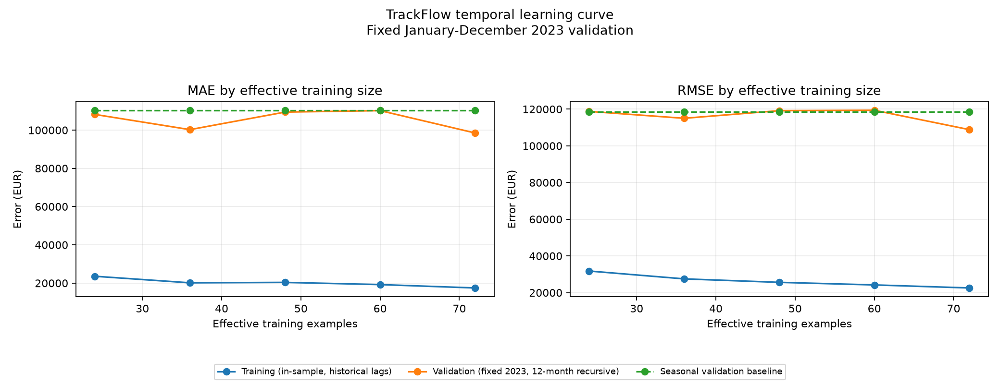

# TrackFlow — Evaluación temporal del modelo de regresión

## A. Objetivo empresarial

Evaluar la fiabilidad técnica del Random Forest mensual antes de considerar una
promoción posterior. Este informe no autoriza staging ni producción.

MAE en EUR es la métrica principal porque expresa el error mensual típico en
unidades directamente interpretables. RMSE es secundaria y aumenta el peso de
errores mensuales grandes. `CONTEXT.md` y `memory-bank/projectbrief.md` respaldan
una facturación empresarial aproximada de €9 millones anuales, pero no indican el
periodo de referencia. El CSV consolidado suma €9,384,261.30 en 2016 y
€14,418,668.57 en 2023. Por ello, la cifra contextual no se trata como el total de
2023 ni como una reconciliación contable del dataset. Ninguna fuente documenta una
función de costes que demuestre que sobreestimar sea más caro que subestimar.

## B. Dataset y modelo heredado

- Dataset oficial: `pipelines/raw/trackflow_sales.csv`, SHA-256
  `2B8C782EFE182AA001DB8044689E3D65E98B2CC17649B598CEDB665E7D2F4C33`.
- 120 meses consolidados: enero de 2016 a diciembre de 2025.
- Desarrollo temporal: 2016–2023; holdout protegido: 2024–2025.
- Modelo sin cambios: `RandomForestRegressor`, 300 árboles, `max_depth=6`,
  `min_samples_leaf=2`, `max_features=0.8`, `random_state=42`, `n_jobs=1`.
- Features: calendario, tendencia, lags de ingresos 1/2/3/6/12 y estadísticas
  rodantes causales de 3/6/12 meses.
- El pipeline semanal, el dataset, el modelo y los artefactos anteriores no se
  modificaron.

## C. Validación cruzada temporal

Se aplicó `TimeSeriesSplit(n_splits=5, test_size=12)` sobre las 96 filas
originales de 2016–2023. Las features se construyeron después de cada corte. Cada
modelo recibió solo el prefijo de entrenamiento y generó recursivamente los doce
meses siguientes antes de consultar los valores reales de validación.

| Fold | Entrenamiento | Validación | Filas originales / efectivas | Train MAE | Train RMSE | Validation MAE | Validation RMSE | Baseline MAE | Baseline RMSE |
|---:|---|---|---:|---:|---:|---:|---:|---:|---:|
| 1 | 2016-01-01 – 2018-12-01 | 2019-01-01 – 2019-12-01 | 36 / 24 | €15,323.69 | €20,988.72 | €75,905.63 | €91,972.25 | €82,214.05 | €92,021.06 |
| 2 | 2016-01-01 – 2019-12-01 | 2020-01-01 – 2020-12-01 | 48 / 36 | €16,543.97 | €24,086.63 | €84,730.60 | €97,525.17 | €41,870.76 | €52,572.19 |
| 3 | 2016-01-01 – 2020-12-01 | 2021-01-01 – 2021-12-01 | 60 / 48 | €17,702.57 | €22,758.21 | €70,297.11 | €85,578.17 | €78,871.75 | €88,990.66 |
| 4 | 2016-01-01 – 2021-12-01 | 2022-01-01 – 2022-12-01 | 72 / 60 | €17,876.10 | €23,319.31 | €89,921.78 | €105,386.10 | €41,262.44 | €53,389.92 |
| 5 | 2016-01-01 – 2022-12-01 | 2023-01-01 – 2023-12-01 | 84 / 72 | €17,464.36 | €22,557.48 | €98,484.94 | €108,834.05 | €110,373.73 | €118,540.79 |

### Resumen de estabilidad

| Métrica | Media ± desviación estándar muestral |
|---|---:|
| Train MAE | EUR 16,982.14 ± EUR 1,059.85 |
| Train RMSE | EUR 22,742.07 ± EUR 1,145.60 |
| Validation MAE | EUR 83,868.01 ± EUR 11,164.85 |
| Validation RMSE | EUR 97,859.15 ± EUR 9,522.25 |
| Baseline MAE | EUR 70,918.54 ± EUR 29,456.80 |
| Baseline RMSE | EUR 81,102.93 ± EUR 28,129.30 |

El MAE medio del Random Forest es
`18.26%` mayor que el del
baseline, aunque lo mejora en `3` de 5
folds. El MAE de validación abarca
`€70,297.11` a
`€98,484.94`, con coeficiente
de variación `0.133`.
Esto indica variabilidad moderada entre años, pero no estabilidad productiva.

## D. Curva de aprendizaje con validación fija

La curva principal mantiene fija la validación enero–diciembre de 2023 y el origen
diciembre de 2022. Utiliza las 36, 48, 60, 72 y 84 observaciones más recientes
disponibles antes de 2023, sin discontinuidades; equivalen a 24, 36, 48, 60 y 72
ejemplos efectivos. Así se elimina el cambio de año de validación que afectaba a la
curva original, mientras los cinco folds anteriores se conservan como evaluación
independiente de estabilidad temporal.

| Filas originales / efectivas | Ventana de entrenamiento | Train MAE | Train RMSE | Validation MAE 2023 | Validation RMSE 2023 | Baseline MAE |
|---:|---|---:|---:|---:|---:|---:|
| 36 / 24 | 2020-01-01 – 2022-12-01 | €23,574.43 | €31,777.91 | €108,198.15 | €118,774.18 | €110,373.73 |
| 48 / 36 | 2019-01-01 – 2022-12-01 | €20,149.56 | €27,498.86 | €100,250.69 | €115,019.24 | €110,373.73 |
| 60 / 48 | 2018-01-01 – 2022-12-01 | €20,366.62 | €25,610.18 | €109,431.32 | €119,182.86 | €110,373.73 |
| 72 / 60 | 2017-01-01 – 2022-12-01 | €19,219.83 | €24,204.09 | €110,192.62 | €119,390.19 | €110,373.73 |
| 84 / 72 | 2016-01-01 – 2022-12-01 | €17,464.36 | €22,557.48 | €98,484.94 | €108,834.05 | €110,373.73 |

La curva anterior combinaba aumento de muestra con validaciones en años distintos;
la nueva mantiene año, origen y horizonte constantes. En ambas, los errores de
entrenamiento proceden de predicción dentro de muestra con lags reales y los de
validación son pronósticos recursivos. La nueva comparación aísla mejor el efecto
del tamaño/ventana histórica, pero esa diferencia de régimen predictivo permanece.

El MAE fijo no evoluciona monótonamente con el tamaño (`r=-0.272`), pero la ventana
mayor obtiene el mejor resultado: €98,484.94, un 8.98% menos que la ventana menor.
Las cinco ventanas superan por MAE al baseline 2023 de €110,373.73. Esto contrasta
con la validación cruzada, donde el Random Forest tiene un MAE medio 18.26% peor que
el baseline, y demuestra que el año evaluado influía materialmente en la curva
anterior.

### Error por horizonte

| Mes de horizonte | MAE medio | RMSE conjunto |
|---:|---:|---:|
| 1 | €83,521.29 | €94,302.32 |
| 2 | €34,889.46 | €45,768.06 |
| 3 | €91,603.94 | €110,754.51 |
| 4 | €53,939.96 | €60,243.94 |
| 5 | €96,849.72 | €102,340.23 |
| 6 | €79,688.84 | €83,638.89 |
| 7 | €89,310.05 | €102,413.74 |
| 8 | €92,730.23 | €104,298.11 |
| 9 | €34,763.82 | €46,780.96 |
| 10 | €81,921.48 | €101,073.94 |
| 11 | €143,422.37 | €147,799.36 |
| 12 | €123,774.97 | €125,774.29 |

El MAE medio de los meses 7–12 es
`28.47%` mayor que el de
los meses 1–6 y su correlación lineal con el horizonte es
`0.495`.
El MAE medio es mayor en la segunda mitad del horizonte, pero la serie no aumenta de forma monotónica. Esto es compatible con propagación recursiva, estacionalidad o cambios temporales; no identifica por sí solo una causa.

## E. Diagnóstico explícito

**Overfitting.** La brecha entre MAE de entrenamiento y validación persiste al mantener fijo 2023 como año de validación para los cinco tamaños, y la validación cruzada también muestra errores fuera de muestra mayores y un MAE medio peor que el baseline. La evidencia es mixta porque las cinco ventanas fijas sí superan el MAE del baseline de 2023 y la ventana mayor obtiene el mejor MAE fijo. Aun así, la brecha persistente respalda overfitting como etiqueta académica principal, sin identificar una causa única.

- Ratio validation/train MAE: `4.939`.
- Ratio validation/baseline MAE: `1.183`.
- Coeficiente de variación del MAE de validación: `0.133`.
- Ratios validation/train de la curva fija: `4.590, 4.975, 5.373, 5.733, 5.639`.
- Cambio de MAE fijo, ventana mayor frente a menor: `-8.98%`.
- Correlación entre tamaño efectivo y MAE fijo: `-0.272`.

Incertidumbre: Incluso con 2023 fijo, la brecha compara error dentro de muestra con un pronóstico recursivo de doce meses. Puede incorporar sobreajuste, propagación de errores, estacionalidad no capturada o limitaciones de extrapolación; la validación disponible no separa causalmente esas explicaciones. La etiqueta describe el patrón principal
observado; no demuestra por sí sola su causa.

## F. Acción correctiva

Como experimento correctivo, no como solución garantizada, comparar una regularización mayor del Random Forest (menor profundidad y/o mayor min_samples_leaf) mediante la curva fija y los cinco folds temporales, sin utilizar 2024-2025 para seleccionar parámetros. Si la brecha no disminuye, investigar por separado propagación recursiva y representación causal de tendencia.

La acción no se aplicó ni se presenta como solución garantizada. Cualquier
experimento posterior debe conservar la curva fija, los cinco folds, el mismo
baseline y mantener 2024–2025 fuera de la selección.

## G. Conclusión empresarial

No se recomienda promover este modelo a staging en el estado actual. Aunque la
evaluación es reproducible y causal, el diagnóstico y la comparación con el
baseline requieren resolver la acción propuesta y volver a superar los gates
temporales. Esta es una recomendación técnica, no una autorización operativa.

## H. Limitaciones y excepciones

- Histórico pequeño: 96 meses de desarrollo y entre 24 y 72 ejemplos efectivos.
- Solo cinco folds; cada validación corresponde a un año distinto.
- La curva fija usa ventanas móviles recientes: al variar el tamaño también cambia
  el inicio histórico, aunque año, origen y horizonte de validación permanezcan fijos.
- El error de entrenamiento dentro de muestra no es directamente equivalente al
  pronóstico recursivo de validación.
- Los folds usan horizonte 12; el holdout histórico anterior usó 24 meses.
- Los resultados 2024–2025 del proyecto anterior ya son conocidos, pero quedaron
  excluidos de folds, diagnóstico y recomendación nuevos.
- Random Forest no extrapola tendencias fuera de los patrones observados de forma
  natural; el presente diseño no atribuye causalmente los errores a esa limitación.
- Los artefactos se encuentran en `pipelines/eval/` por autorización del usuario,
  no en la ruta académica `data/eval/`. Esto no acredita aceptación académica.
